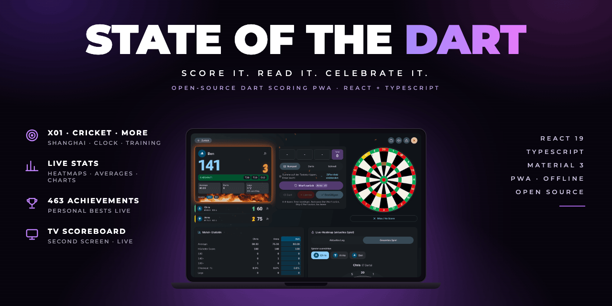
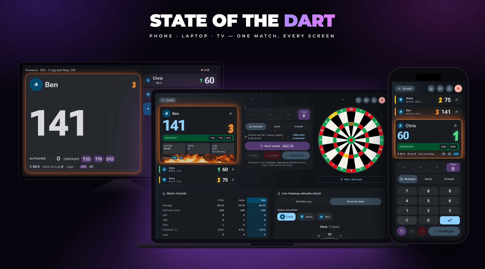
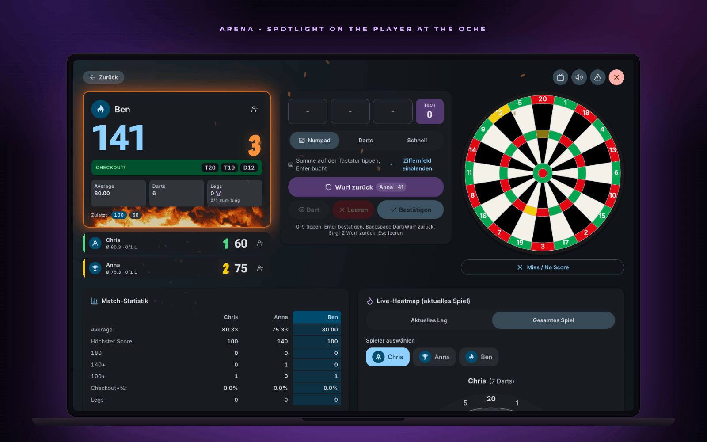
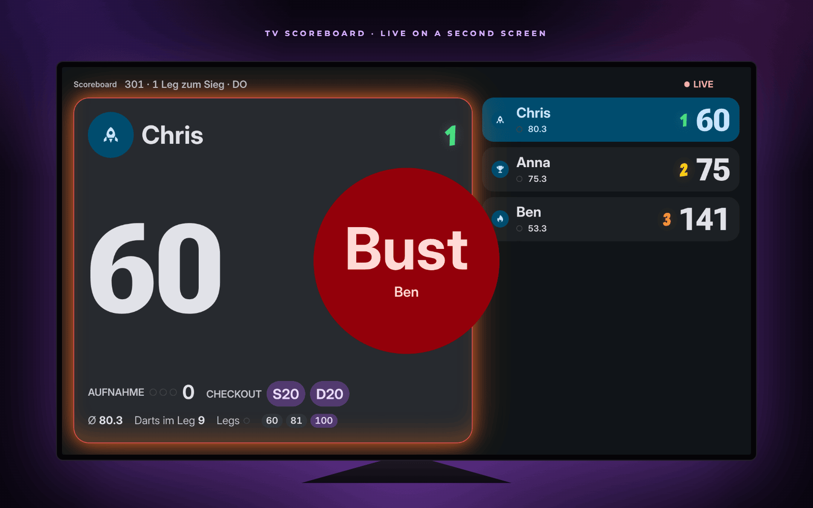
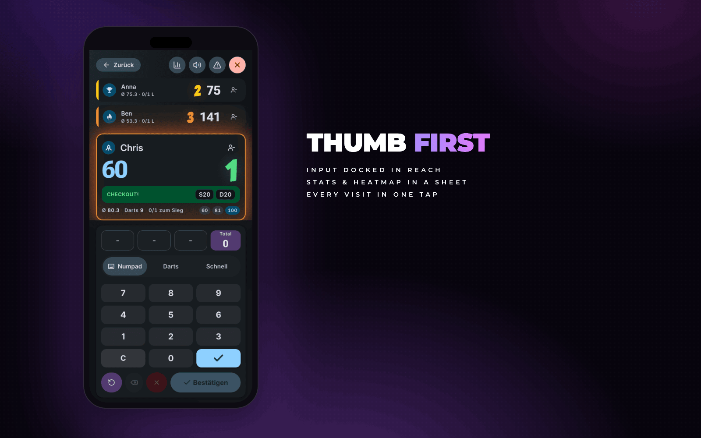
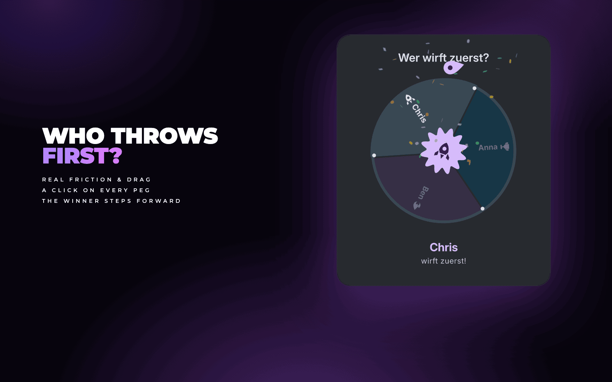
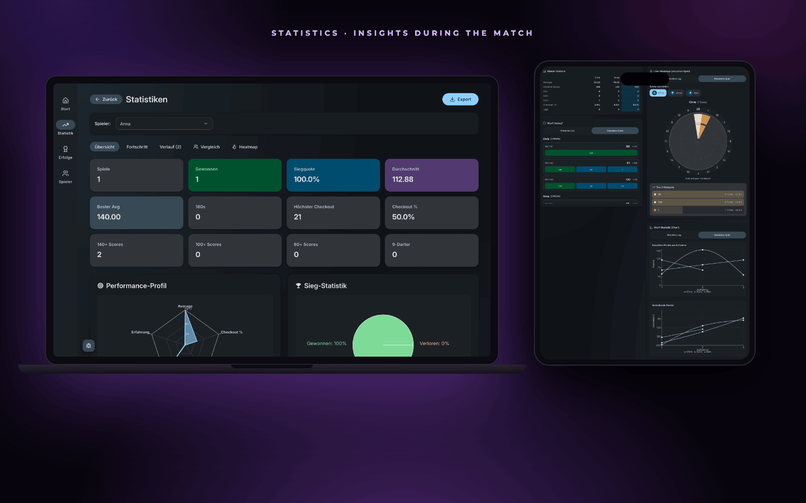
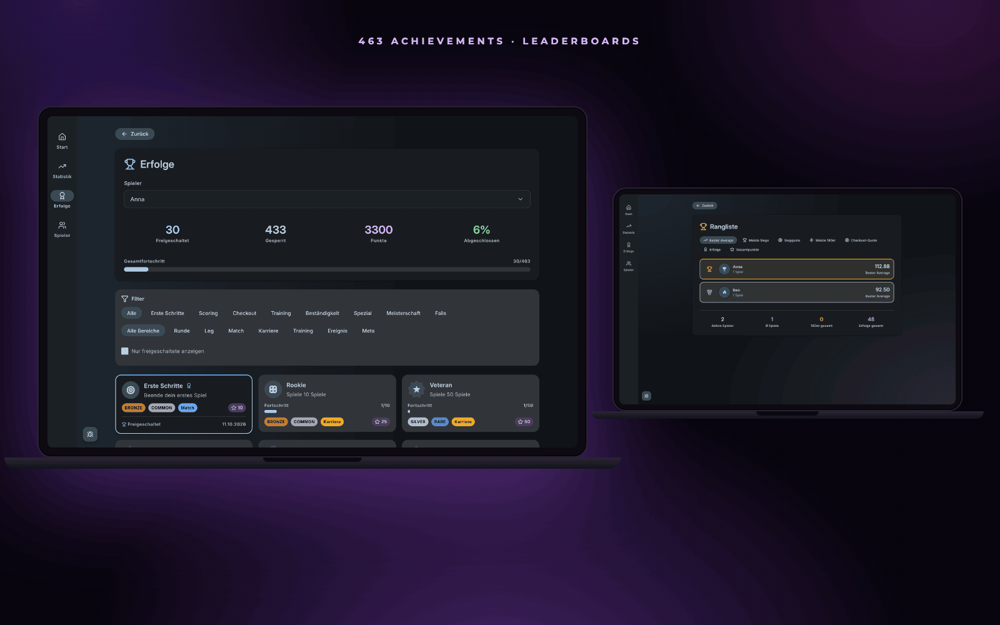

<div align="right">

**🇩🇪 Deutsch** · [🇬🇧 English](docs/README.en.md)

</div>

<div align="center">
  

  # 🎯 State of the Dart

  > **Das Dart-Zählsystem für Kneipe, Keller und Verein: X01, Cricket, Shanghai und Training mit Live-Statistik, Heatmaps, 463 Achievements, Online-Multiplayer und TV-Scoreboard — eine installierbare Web-App für Handy, Tablet, Laptop und Fernseher.**

  Summe tippen, Enter — der nächste Spieler ist sofort dran. Die große Karte zeigt, wer am Zug ist, den Rest, den Checkout-Weg und den Platz im Leg; eine 180 bekommt den Bildschirm, und der Fernseher zeigt alles live mit. Läuft offline, synchronisiert über das eigene Konto, ohne Werbung.

  <h3>🌐 <a href="https://stateofthedart.com">stateofthedart.com</a> — direkt im Browser spielen</h3>

  <p>
    <a href="https://stateofthedart.com">
      
    </a>
    <a href="https://stateofthedart.celox.io">
      
    </a>
  </p>

  <em>Kostenlos im Browser, als App installierbar, keine Werbung. Die Website zeigt alle Funktionen auf einen Blick.</em>

  <p>
    <a href="https://www.paypal.com/donate/?business=martin.pfeffer@celox.io&item_name=State+of+the+Dart&currency_code=EUR">
      
    </a>
  </p>

  <em>Ein Ein-Personen-Projekt aus Berlin, gebaut an Abenden und Wochenenden. Wenn State of the Dart euren Spieleabend leichter macht, <a href="https://www.paypal.com/donate/?business=martin.pfeffer@celox.io&item_name=State+of+the+Dart&currency_code=EUR">spendiert einen Kaffee</a> ☕ — jede Tasse wird zur nächsten Funktion.</em>

  ### ✨ Was es kann (kurz)

  - 🎯 **X01 bis 1001** mit Check-in/Check-out Single, Double oder Triple, Sätzen und Legs, Bots in 10 Stärken
  - ⌨️ **Schnell zählen:** Summe tippen + Enter, einzelne Darts, Schnellwerte oder das Dartboard — Korrektur über Leg- und Satzgrenzen
  - 🔦 **Spotlight-Spielansicht:** große Karte für den Spieler am Zug mit Checkout-Weg, Platz im Leg und brennendem Rahmen
  - 📐 **Für jede Bildschirmgröße:** Eingabe im Daumenbereich am Handy, zwei Spalten am Tablet, drei mit Dartboard am Laptop, ohne Breitendeckel am XXL-Monitor
  - 📺 **TV-Scoreboard** auf dem zweiten Bildschirm, live bei jeder Aufnahme
  - 🎉 **Feedback-Leiter:** Funken ab 100, 180-Moment, Leg-Rückblick, neue Bestwerte live, Vibration je Stufe
  - 🎡 **Glücksrad** für den Anwurf mit echter Physik
  - 📊 **Statistik & Heatmaps** feldgenau, Verlauf, Vergleich, Bestenlisten
  - 🏆 **463 Achievements** in fünf Stufen mit eigenen Formen
  - 🎮 **Cricket, Around the Clock, Shanghai, 6 Trainingsmodi, Turniere, Online-Multiplayer**
  - 🔊 **Caller mit 609 Sprachdateien** · 🌍 Deutsch und Englisch · ♿ WCAG 2.1 AA geprüft
  - 📴 **Offline-first PWA** mit Konto-Sync, Fortsetzen nach Refresh, keine Werbung

  ### 🧰 Tech-Stack

  React 19 · TypeScript 5 · Vite · Tailwind · Material 3 Expressive (eigene Federn, Formen, Icons) · Framer Motion · WebGL · Express · SQLite · Socket.IO · Workbox. **1212 Unit-Tests + 48 E2E-Tests.** MIT-lizenziert.

  <!-- ── Headline metrics ─────────────────────────────────────── -->
  <p>
    <a href="https://github.com/pepperonas/state-of-the-dart" title="Lines of code — measured by scripts/count-loc.mjs, checked by the docs test">
      
    </a>
    &nbsp;
    <a href="https://github.com/pepperonas/state-of-the-dart/actions/workflows/test.yml" title="Vitest unit and component tests, all passing">
      
    </a>
    &nbsp;
    <a href="https://github.com/pepperonas/state-of-the-dart/actions/workflows/e2e.yml" title="Playwright end-to-end tests against a real backend">
      
    </a>
  </p>

  <!-- ── Highlights ───────────────────────────────────────────── -->
  <p>
    <a href="LICENSE"></a>
    <a href="CHANGELOG.md"></a>
    <a href="https://stateofthedart.com"></a>
    <a href="https://react.dev"></a>
    <a href="https://www.typescriptlang.org"></a>
    <a href="https://m3.material.io"></a>
    <a href="#"></a>
    <a href="#"></a>
  </p>

  <!-- ── Build & repository (live) ────────────────────────────── -->
  [](https://github.com/pepperonas/state-of-the-dart/actions/workflows/test.yml)
  [](https://github.com/pepperonas/state-of-the-dart/actions/workflows/e2e.yml)
  [](https://github.com/pepperonas/state-of-the-dart/commits)
  [](https://github.com/pepperonas/state-of-the-dart/pulse)
  [](https://github.com/pepperonas/state-of-the-dart/issues)
  [](https://github.com/pepperonas/state-of-the-dart/pulls)
  [](https://github.com/pepperonas/state-of-the-dart/stargazers)
  [](https://github.com/pepperonas/state-of-the-dart/network/members)
  [](https://github.com/pepperonas/state-of-the-dart/tags)
  [](https://github.com/pepperonas/state-of-the-dart)
  [](https://github.com/pepperonas/state-of-the-dart)
  [](https://github.com/pepperonas/state-of-the-dart)
  [](https://github.com/pepperonas/state-of-the-dart)
  [](https://github.com/pepperonas/state-of-the-dart/commits)

  <!-- ── Frontend ─────────────────────────────────────────────── -->
  
  
  
  
  
  
  
  
  
  

  <!-- ── Backend ──────────────────────────────────────────────── -->
  
  
  
  
  
  
  
  

  <!-- ── Quality ──────────────────────────────────────────────── -->
  
  
  
  
  
  
  
  
  
  

  <!-- ── Code base ────────────────────────────────────────────── -->
  
  
  
  
  
  

  <!-- ── Content ──────────────────────────────────────────────── -->
  
  
  
  
  
  
  
  
  
  
  
  

  <!-- ── Conventions & community ─────────────────────────────── -->
  [](https://www.conventionalcommits.org/)
  [](CHANGELOG.md)
  [](https://semver.org/)
  [](CONTRIBUTING.md)
  [](CODE_OF_CONDUCT.md)
  [](SECURITY.md)
  [](https://www.paypal.com/donate/?business=martin.pfeffer@celox.io&item_name=State+of+the+Dart&currency_code=EUR)
  [](https://celox.io)

  🌐 **[Live-App](https://stateofthedart.com)** · 🏠 **[Website](https://stateofthedart.celox.io)** · 🏗️ **[Architektur](docs/ARCHITECTURE.md)** · 🎨 **[Design-System](docs/DESIGN_SYSTEM.md)** · 🚀 **[Deployment](docs/DEPLOYMENT_VPS.md)** · 📝 **[Changelog](CHANGELOG.md)** · 🐛 **[Issues](https://github.com/pepperonas/state-of-the-dart/issues)**

</div>

---

## 📸 Screenshots

<div align="center">
  
</div>

<table>
  <tr>
    <td width="50%"><br><sub><b>Arena</b> — Spotlight auf dem Spieler am Zug, Eingabe und Dartboard daneben</sub></td>
    <td width="50%"><br><sub><b>TV-Scoreboard</b> — der Spielstand live auf dem Fernseher, mit Momenten</sub></td>
  </tr>
  <tr>
    <td><br><sub><b>Handy</b> — Eingabe im Daumenbereich, Statistik im Bottom Sheet</sub></td>
    <td><br><sub><b>Glücksrad</b> — wer wirft zuerst, mit echter Physik</sub></td>
  </tr>
  <tr>
    <td><br><sub><b>Statistik</b> — Übersicht, Heatmap und Einblicke während des Spiels</sub></td>
    <td><br><sub><b>Achievements</b> — 463 Erfolge und Ranglisten</sub></td>
  </tr>
</table>

<div align="center">

**[📸 Alle Screenshots ansehen →](SCREENSHOTS.md)**

</div>

---

## ✨ Features

### 👥 Multi-User & Authentication System
- **Benutzerregistrierung** - E-Mail-Registrierung mit Verifizierung
- **Sichere Authentifizierung** - JWT-basierte Authentifizierung mit bcrypt
- **Google OAuth** - Schnelle Anmeldung mit Google-Konto
- **30-Tage-Testzeitraum** - Kostenlose Testphase für alle neuen Benutzer
- **Stripe-Integration** - Monatliche oder Lifetime-Abonnements
- **Persönliche Profile** - Jeder Benutzer hat eigene isolierte Profile mit separaten Daten
- **Profilverwaltung** - Einfaches Wechseln zwischen Profilen mit visuellen Avataren
- **Datenisolation** - Vollständige Trennung von Stats, Einstellungen und Spielhistorie
- **Cloud-Synchronisation** - Automatische Datensicherung in der Cloud
- **👑 Admin-System** - Vollständige User-Management-Funktionen für Administratoren

### 🎮 Spielmodi
- **X01-Spiele** - Vollständige Unterstützung für 301/501/701/1001 mit anpassbaren Einstellungen
- **🎯 Cricket-Modus** - Vollständiger Cricket-Spielmodus
  - Zahlen 15-20 und Bull müssen 3x getroffen werden
  - Triple = 3 Marks, Double = 2 Marks, Single = 1 Mark
  - Punkte sammeln nach dem Schließen (solange Gegner offen)
  - Mark-Anzeige: `/` (1), `X` (2), `⊗` (geschlossen)
- **🕐 Around the Clock (NEU in v0.3.0)** - Klassischer Trainingsmodus
  - Triff Zahlen 1-20 der Reihe nach
  - Optional mit Bull als Finale
  - Optionen: Doubles/Triples erlaubt
  - Timer und Dart-Zähler
- **⚡ Shanghai (NEU in v0.3.0)** - Bonus-Runden Spielmodus
  - Jede Runde zielt auf eine bestimmte Zahl
  - Single/Double/Triple für Punkte
  - SHANGHAI (S+D+T) = Sofortiger Sieg!
  - Konfigurierbare Startnummer und Runden
- **🌐 Online Multiplayer (NEU in v0.3.0)** - Echtzeit-Spiele
  - WebSocket-basierte Verbindung
  - Öffentliche und private Räume erstellen
  - Raum-ID kopieren und teilen für private Räume
  - Per Raum-Code einem privaten Raum beitreten
  - Live-Chat während des Spiels
  - Bis zu 4 Spieler pro Raum
- **Check-in / Check-out** - je Single, Double oder Triple (z. B. Double-Out, Triple-Out mit Finish bis 180)
- **Best of Sets/Legs** - Turnier-Matchformate
- **Multi-Player** - Unterstützung für 2+ Spieler mit eigenen Avataren und Namen
- **Match fortsetzen (v0.5.0 / erweitert v0.8.4)** - Alle Spielmodi pausieren und später fortsetzen
  - Automatische Pause beim Starten eines neuen Spiels
  - Resume-Liste mit X01 (API) + ATC/Shanghai/Cricket (localStorage)
  - Deterministische Match-Namen aus UUID (z.B. "Cosmic Tiger")
  - Vollständige Match-Rekonstruktion aus der Datenbank
  - 48h-Ablaufzeit für localStorage-Spielstände
- **Trainingsmodi** - 6 Trainingsmodi inkl. Doubles/Triples-Training, Around the Clock und Bob's 27

### 🖥️ Spielansicht „Arena“ & TV-Scoreboard (v0.28–v0.31)
- **Spotlight** — wer am Zug ist, bekommt eine große Hero-Karte (riesiger Rest, Checkout-Weg, Platz im Leg, Darts im Leg, Schnitt, Legs bis zum Sieg, letzte Aufnahmen); alle anderen stehen als kompakte Zeilen darunter. Beim Spielerwechsel wächst die Zeile des Nächsten als Ganzes zur Hero-Karte (M3 Container Transform), ohne dass Schrift gestreckt wird.
- **Wurf vor (v0.35.0)** — zu viel zurückgenommen? „Wurf vor“ (oder Strg+Umschalt+Z / Strg+Y) bucht die Aufnahmen der Reihe nach wieder, Bot-Aufnahmen inklusive.
- **Spielerwechsel als Staffelstab (v0.34.0)** — nach einer Aufnahme bleibt die Karte des Werfers einen Moment groß: „−60“ landet als Stempel, der Rest zählt sichtbar herunter. Dann öffnet sich die Karte des Nächsten aus seiner Zeile, sein Name baut sich Buchstabe für Buchstabe auf, die Zahl wächst mit, ein Ring sagt „du bist dran“, danach kommt das Feuer. Die Eingabe ist dabei sofort frei; Screenreader hören sofort den richtigen Spieler.
- **Für jede Bildschirmgröße** (M3 Window Size Classes) — Handy: Eingabe unten im Daumenbereich, Statistik/Verlauf/Heatmap/Board als Bottom Sheet mit Reitern; Tablet quer: zwei Spalten; ab Laptop: drei Spalten mit Dartboard daneben; sehr große Monitore ohne schmale Begrenzung.
- **Einblicke unter dem Spielfeld** — Match-Statistik (alle Spieler nebeneinander), Wurf-Verlauf, Wurf-Chart und Live-Heatmap als Karten in zwei Spalten, immer offen.
- **Feedback-Leiter** — große Zahlen in Roboto Flex, die bei jeder Änderung kurz anschwellen; Funken ab 100, eine 180 bekommt den Bildschirm (Formwechsel Kreis → Strahlenkranz, Konfetti), Leg-Rückblick mit Darts/Schnitt/Checkout, neue Bestwerte live — nie blockierend, ein eigenes Vibrationsmuster je Stufe.
- **Glücksrad „Wer wirft zuerst?“** — dreht mit echter Physik (Reibung + Luftwiderstand), Zeiger klackt an jedem Stift mit Ton und Vibration, Siegerfeld tritt hervor.
- **TV-Scoreboard** (`/scoreboard`) — das Bildschirm-Symbol in der Spielansicht öffnet den Spielstand in einem eigenen Fenster für Fernseher, Beamer oder zweiten Monitor: Rest des Spielers am Zug auf etwa einem Drittel der Bildhöhe, laufende Aufnahme, Checkout-Weg, alle Spieler mit Platz und Rest, Momente für 180/100+/Bust/Leg und der Sieger. Aktualisiert sich bei jeder Aufnahme sofort (gleiches Gerät und gleicher Browser, kein Server), Vollbild per Knopf, Mauszeiger blendet sich aus. Das Fenster liest nur und kann nie einen Spielstand zurückschreiben.

### 🏆 Turniersystem (NEU in v0.2.0)
- **Knockout-Modus** - Single Elimination Turniere
  - 4-16 Spieler unterstützt
  - Automatische Bracket-Generierung
  - Gewinner rückt automatisch in nächste Runde vor
- **Round Robin-Modus** - Jeder gegen jeden
  - 3-8 Spieler unterstützt
  - Automatische Paarungsgenerierung
  - Live-Tabelle mit Siegen, Niederlagen, Leg-Differenz
- **Live-Tabelle** mit Medaillen (🥇🥈🥉)
- **Match-Scoring** direkt im Turnier
- **Best-of-X** konfigurierbar (2-5 Legs)
- **Turniersieger-Anzeige** mit Konfetti-Animation

### 📊 Erweiterte Statistiken & Charts
- **10+ interaktive Charts** - Wunderschöne Visualisierungen mit Recharts
  - Radar-Chart: Performance-Profil (Average, Checkout %, 180s, Win Rate)
  - Pie-Chart: Sieg/Niederlage-Statistik
  - Bar-Charts: Score-Verteilung, High Scores
  - Linien-Charts: Average- und Checkout-Entwicklung
  - **Runden-Chart**: Match-Verlauf Runde für Runde (3 Würfe = 1 Runde)
  - Area-Charts: Legs Gewonnen/Verloren
  - Composed-Charts: Monatliche Performance-Trends
- **Spielervergleich** - Vergleiche bis zu 4 Spieler nebeneinander mit:
  - Radar-Chart: 5-dimensionaler Skill-Vergleich
  - Stats-Tabelle: Detaillierter Head-to-Head-Vergleich
  - Bar-Chart: Visuelle Metrik-Vergleiche
- **Echtzeit-Stats** - Live-Scoring mit sofortiger Berechnung
- **Spieler-Statistiken** - Average, Checkout %, High Scores, 180s, 171+, 140+, 100+
- **Match-Historie** - Vollständiges Tracking aller gespielten Spiele
  - **Spielhistorie-Seite (NEU in v0.6.0)** - Eigene Seite im Hauptmenü mit allen Matches, Detail-Ansicht mit Charts, Heatmaps und Wurf-Verlauf
  - **Suchfunktion & Pagination** - Durchsuche Matches nach Gegner, Datum oder Spieltyp und blättere durch Seiten
  - **Wurfverlauf im Detail-Modal** - Zeigt alle Würfe pro Spieler wie im laufenden Spiel
- **Trendanalyse** - Verbesserungs-Metriken und Performance-Trends
- **Persönliche Bestleistungen** - Tracke höchste Checkouts, beste Averages, 9-Darter
- **Multi-Format Export (NEU in v0.1.0)** - Exportiere Statistiken in 3 Formaten:
  - **CSV Export** - Text-basiert, kompatibel mit Excel/Google Sheets
  - **Excel Export (.xlsx)** - Native Excel-Dateien mit Summary-Sheet
  - **PDF Export** - Professionelle Reports mit formatierten Tabellen
- **Export/Import** - JSON für vollständige Datensicherung
- **Automatische Synchronisation** - Stats werden automatisch nach jedem Match aktualisiert

### 🏆 Achievements & Gamification (Komplett-Rewrite in v0.4.0)
- **463 Achievements** - In 8 Kategorien (Erste Schritte, Scoring, Checkout, Training, Konsistenz, Spezial, Meisterschaft, Fails)
- **Achievement-Synchronisation** - Achievements werden automatisch in der Datenbank gespeichert und bleiben erhalten
- **Tier-System** - Bronze, Silber, Gold, Platin, Diamant
- **Seltenheitsstufen** - Common, Rare, Epic, Legendary Achievements
- **Scope-System (NEU in v0.8.3)** - Jedes Achievement zeigt seinen Auslöse-Kontext:
  - 7 Scopes: Runde, Leg, Match, Karriere, Training, Ereignis, Meta
  - Farbige Scope-Badges auf Achievement-Karten und Benachrichtigungen
  - Filter nach Scope im Achievement-Screen
  - Deterministisch berechnet aus Metric/Type/Target (kein manuelles Pflegen)
- **Fortschritts-Tracking** - Kumulative Metriken (Spiele, Siege, 180s etc.) akkumulieren korrekt
- **AAA-Game-Feel Benachrichtigungen (NEU in v0.4.0)** - Cinematic Achievement-Popups:
  - Fullscreen-Flash-Overlay beim Freischalten (Tier-Farbe)
  - Spring-Animation Card-Entrance mit Overshoot
  - Tier-basierte Confetti-Partikel (Bronze: 30, Diamond: 200+ mit Shimmer-Rain)
  - Pulsierender Glow-Border mit Tier-Farbe
  - Countdown-Progressbar (5-10s je nach Tier)
  - Sound-Feedback beim Freischalten
  - Notification-Queue: Mehrere Achievements werden nacheinander angezeigt
- **Umfassende Dart-Analyse (NEU in v0.4.0)** - Segment-Level Achievement-Tracking:
  - Jeder Dart wird auf Triples, Doubles, Singles, Bulls, Misses analysiert
  - Visit-Pattern-Erkennung: Shanghai, Robin Hood, Triple-Triple, Same-Segment
  - Checkout-Analyse: Double-Identifikation (D20, D16, D1...), 1/2-Dart-Finishes
  - Kalender-Achievements: Mitternacht, Wochenende, Feiertage (Weihnachten, Neujahr, Halloween)
- **Meta-Achievements** - Werden automatisch bei Punktestand-/Unlock-Meilensteinen geprüft
- **Punktesystem** - Verdiene Punkte für Achievements (bis zu 1000 pro Achievement)
- **Versteckte Achievements** - Spezielle geheime Achievements zum Entdecken
- **Achievement-Hinweise** - Zeigt Fortschritt an, wenn du kurz vor einem Achievement stehst

### 👤 Spielerprofile & Bestenliste
- **Detaillierte Spielerprofile** - Individuelle Seiten für jeden Spieler mit:
  - **Klickbare Spielerliste** - Gesamter Listeneintrag führt zur Detailansicht
  - **Suchfunktion & Pagination (NEU)** - Durchsuche Spielerliste und blättere durch Seiten (10/20/50/100 pro Seite)
  - **8 Persönliche Bestleistungen** - Höchster Score, bester Average, meiste 180s, höchstes Checkout, beste Checkout-Rate, kürzestes Leg, längste Siegesserie, meiste Legs gewonnen
  - **Performance-Charts** - Verfolge Verbesserungen über die letzten 10 Spiele
  - **Skill-Radar** - 5-dimensionale Skill-Visualisierung
  - **Karriere-Zeitachse** - Vom ersten bis zum letzten Spiel mit allen Stats
  - **Achievement-Showcase** - Zeige freigeschaltete Achievements
  - **Player Avatar System** - Tonale Avatar-Discs mit Icons aus dem hauseigenen Set (siehe [Design-System](docs/DESIGN_SYSTEM.md)); ältere Profile mit Emoji werden automatisch übersetzt. Seit v0.33.0 zusätzlich **165 Spieler-Symbole von [game-icons.net](https://game-icons.net)** (Tiere, Fantasy, Sport & Spiel, Kneipe, Musik & Party, Natur & Weltall, Zeichen, Fahrzeuge), auf Deutsch durchsuchbar, einfarbig im Theme; die Pfaddaten werden erst bei Bedarf geladen. Seit v0.35.0 außerdem **alle Emojis** (1906, neun Gruppen, fünf Hauttöne) im Reiter „Emojis“, auf Deutsch und Englisch durchsuchbar
  - **🔥 Feldgenaue Heatmap (neu gebaut in v0.19.0)** - Wurfverteilung auf der Scheibe:
    - Jedes echte Feld (Single, Triple, Double, Single-Bull, Bull) wird nach seiner Trefferquote eingefärbt — scharfes SVG in jeder Größe, folgt hellem und dunklem Theme
    - Eine warme, wahrnehmungstreue Farbrampe (`--m3-heat-1…6`), Wurzel-Skala, damit ein Hauptfeld nicht alles andere ausgraut
    - Fehlwürfe stehen neben der Scheibe, nicht auf ihr
    - Feld antippen zeigt Treffer und Anteil; die Feldliste darunter ist der Tastatur- und Screenreader-Weg
    - Triple-, Double-, Bull- und Fehlwurfquote sowie die **bevorzugte Zone** (stärkste Zahl und wohin die Darts zu den Nachbarn abweichen)
    - Ehrlich: Die App speichert das getroffene Feld, nicht die genaue Stelle — deshalb keine erfundene Streuwolke
- **Bestenlisten-Rankings** - Wettbewerbs-Rankings in 7 Kategorien:
  - Bester Average, Meiste Siege, Win-Rate, Meiste 180s, Checkout-Rate, Achievements, Gesamtpunkte
  - Top 3 bekommen spezielle Medaillen (🏆 Gold, 🥈 Silber, 🥉 Bronze)
  - Klicke auf jeden Spieler, um sein Profil anzuzeigen
- **Globale Bestenliste** - Wetteifere mit Spielern weltweit

### 👑 Admin-System
- **User-Management** - Vollständige Verwaltung aller registrierten Benutzer
- **Subscription-Kontrolle** - Gewähre oder widerrufe Lifetime-Access
- **Erweiterte Abo-Verwaltung (NEU in v0.1.8)** - Volle Kontrolle über Subscriptions:
  - Status-Dropdown (expired, trial, active, lifetime)
  - Plan-Dropdown (monthly, annual, lifetime)
  - Expiration Date Picker für individuelle Ablaufdaten
  - Manuelle Premium-Freischaltung für einzelne Accounts
- **Admin-Rechte** - Mache andere Benutzer zu Admins
- **User-Statistiken** - Dashboard mit Gesamtübersicht
- **Filter & Suche** - Filtere nach Subscription-Status (Trial, Active, Lifetime, Expired)
- **Benutzer löschen** - Lösche Benutzer permanent mit allen Daten
- **Echtzeit-Updates** - Änderungen werden sofort angezeigt
- **Debug Flag System (NEU in v0.8.3)** - Integriertes Bug-Reporting für Admins:
  - Floating Flag-Button erfasst Snapshot: Log-Buffer, Screenshot, Browser-Info, Game-State, Route
  - In-Memory Ring-Buffer (1000 Einträge) sammelt alle Logs unabhängig von der Umgebung
  - Status-Workflow: open → investigating → resolved/dismissed
  - "Copy for AI" exportiert strukturierten Debug-Text zur Analyse

#### Nutzungs-Übersicht (nur Admin)
- **Aktivitäts-Chart je Nutzer** — 30-Tage-Balkendiagramm aus Matches **und** Trainings-Sessions. Skaliert auf das eigene Maximum der Zeile, nicht auf ein globales: die Frage ist „wann war diese Person aktiv", nicht „wer ist am aktivsten". Ein ruhiger Tag bleibt als feiner Grundstrich sichtbar, damit die Zeile als Zeitachse lesbar ist.
- **Zuletzt aktiv** — relative Angabe („vor 3 Tagen"), eingefärbt nach Frische: grün ≤ 7 Tage, neutral ≤ 30, rot darüber. Das exakte Datum steht im Tooltip.
- **Filter nach Nutzer** in den Tabellen für Bug Reports und Debug Flags. Die Auswahl wird aus den tatsächlich vorhandenen Einträgen gebaut — ein Filter, der leere Konten anbietet, ist Rauschen; einer, der einen Melder auslässt, versteckt dessen Einträge.

> Die Daten kommen aus `GET /api/admin/users`, das hinter `requireAdmin` liegt — sie erreichen einen Nicht-Admin-Client also gar nicht erst.

#### Wer darf was melden
| | Bug Report | Debug Flag |
|---|---|---|
| Angemeldeter Nutzer | ✅ anlegen, eigene sehen | ❌ |
| Admin | ✅ alle sehen, Status/Notizen setzen | ✅ vollständig |

Ein **Bug Report** ist Nutzer-Feedback und steht jedem angemeldeten Konto offen — erreichbar über den 🐞-Knopf unten links auf jedem Bildschirm. Ein **Debug Flag** ist ein Diagnose-Schnappschuss (Log-Puffer, Screenshot, Spielzustand, Route) und bleibt Admins vorbehalten.

### 📴 Offline-First PWA (NEU in v0.2.0)
- **Vollständiger Offline-Modus** - App funktioniert ohne Internetverbindung
- **IndexedDB-Speicherung** - Lokale Datenspeicherung mit `idb` Library
- **Pending Actions Queue** - Aktionen werden gespeichert und bei Reconnect synchronisiert
- **NetworkFirst API-Caching** - Intelligentes Caching für Players, Matches, Settings
- **Auto-Sync** - Automatische Synchronisation beim Wiederherstellen der Verbindung
- **Offline-Indicator** - Zeigt aktuellen Verbindungsstatus mit ausstehenden Aktionen
- **PWA-Installation** - Als App auf Smartphone/Desktop installierbar
- **Service Worker** - Hintergrund-Synchronisation und Cache-Management

### 🔊 Professionelles Audio-System
- **Score-Ansagen** - Professionelle Caller-Stimme für jeden Score (0-180)
- **Checkout-Calls** - Spezielle Ansagen für Leg/Set/Match-Siege
- **"Game Shot" Ansage (NEU in v0.1.8)** - Sequentielle Wiedergabe nach Checkout:
  - Score-Ansage → 400ms Pause → "Game Shot"
  - "Game Shot and the Match" für Match-Abschluss
  - Async/await für saubere Audio-Abfolge
- **Bust-Benachrichtigungen** - Klares Audio-Feedback für ungültige Würfe
- **Separate Lautstärke** - Unabhängige Kontrolle für Caller und Effects
- **609 Audio-Dateien** - Vollständiges professionelles Dart-Calling-Erlebnis
- **Lautstärkeregelung** - Separate Regler für Caller (Scores) und Effects (UI-Sounds)

### 📖 User Guide & Dokumentation
- **In-App Anleitung (NEU in v0.1.8)** - Umfassende Dokumentation direkt in der App:
  - 10 detaillierte Sektionen mit Sidebar-Navigation
  - Übersicht, Quickstart, Spiel-Modi, Spieler, Training
  - Statistiken, Achievements, Einstellungen, Admin, Tipps
  - Glass-card Styling mit responsivem Layout
  - Direkter Zugriff aus dem Hauptmenü
  - Click-outside zum Schließen
  - **Aktualisiert (v0.1.9):** Dokumentiert alle neuen Features (Avatar-Auswahl, Undo-System, klickbare Spielerliste)

### 💾 Database Backup System
- **Automatisierte Backups (NEU in v0.1.8)** - Verhindert VPS-Speicher-Überlastung:
  - Tägliche Backups um 3:00 Uhr via Cronjob
  - 7-Tage-Retention (automatische Löschung alter Backups)
  - VACUUM INTO für Kompression und Integrität
  - Timestamped Filenames: `state-of-the-dart_YYYY-MM-DD_HH-MM-SS.db`
- **Restore-Funktion** - Sichere Wiederherstellung mit Rollback:
  - Automatischer PM2-Stop vor Restore
  - Safety-Backup der aktuellen Datenbank
  - Automatischer Rollback bei Fehlern
  - Detaillierte Dokumentation in `BACKUP.md`

### 🎯 Verbesserungen & Training
- **Dashboard Activities (NEU in v0.1.8)** - Intelligente Anzeige letzter Spiele:
  - Zeigt ALLE Matches (nicht nur Main Player)
  - Main Player gewonnen: "Spiel gewonnen!" 🏆
  - Anderer Spieler gewonnen: "{winnerName} gewonnen" 🏆
  - Kein Gewinner: "Match gespielt" 🎯
- **Personal Bests Auto-Update** - Automatische Aktualisierung nach jedem Match
- **Undo-System (NEU in v0.1.9)** - Umfassendes Undo-System:
  - **Undo Last Throw** - Rückgängig-Button für versehentliche Eingaben
  - **Undo Match-Ende** - Versehentlich beendete Matches können fortgesetzt werden
  - **Verlaufsanzeige** - Preview-Panel zeigt entfernte Würfe beim Undo
  - **Statistik-Neuberechnung** - Alle Stats werden beim Undo korrekt aktualisiert
- **Letzte Spieler Quick-Select** - Schnellauswahl der zuletzt verwendeten Spieler
- **Achievement-Fortschritts-Hinweise** - Benachrichtigungen wenn du nahe an einem Achievement bist
- **Sound-Mixing** - Separate Lautstärke für Caller vs. Effects
- **Training-Statistiken** - Detaillierte Charts und Analyse für alle Trainingsmodi
- **Match-Sharing** - Teile deine besten Matches mit anderen

### 🎨 Modernes UI/UX
- **Dark Mode optimiert** - Hochkontrast-Design mit perfekter Lesbarkeit
- **Material 3 Expressive** - durchgängiges Token-System (Farbrollen, Formen, Elevation, Typo) in Dunkel und Hell
- **Responsive Layout** - von Smartphone bis XXL-Monitor, je Bildschirmklasse ein eigenes Layout
- **Federbasierte Animationen** - eine Quelle für alle Federn (`utils/springs.ts`), respektiert „Bewegung reduzieren“
- **Feedback-Leiter** - Funken, 180-Moment, Leg-Rückblick und Siegerfeier, siehe „Spielansicht“

### ⚡ Performance & PWA
- **Progressive Web App** - Auf jedem Gerät installierbar, funktioniert offline
- **Code-Splitting** - Lazy Loading reduziert Initial-Bundle um 70%
- **Service Worker** - Offline-Support mit intelligentem Caching
- **Optimierter Build** - Minifizierte, tree-shaken, gzipped Assets
- **PageSpeed Score** - 90-100 auf allen Metriken (Performance, Accessibility, SEO)
- **Mobile-First** - Touch-optimiert mit 44px Minimum-Targets
- **WCAG 2.1 konform** - Eingebaute Accessibility-Features

---

## 🚀 Quick Start

### Frontend Installation

```bash
# Repository klonen
git clone https://github.com/pepperonas/state-of-the-dart.git
cd state-of-the-dart

# Frontend Dependencies installieren
npm install

# Entwicklungsserver starten
npm run dev
```

Die App läuft auf `http://localhost:5173`

### Backend Installation (für Cloud-Sync & Admin-Features)

```bash
# Backend Setup
cd server

# Dependencies installieren
npm install

# .env Datei erstellen (siehe server/env.example)
cp env.example .env
# Trage deine Credentials ein (SMTP, Stripe, Google OAuth)

# TypeScript kompilieren
npm run build

# Admin-Konto erstellen
npm run create:admin

# Optional: Demo-Daten generieren
npm run seed:demo

# Server starten
npm start
```

Der Backend-Server läuft auf `http://localhost:3002`

📚 **Vollständige Setup-Anleitung**: Siehe [docs/DEPLOYMENT_VPS.md](docs/DEPLOYMENT_VPS.md) und [server/README.md](server/README.md)

### Build für Produktion

```bash
# Production Build erstellen
npm run build

# Build lokal testen
npm run preview
```

### Testing

```bash
# Tests ausführen
npm test

# Tests mit UI
npm run test:ui

# Test Coverage
npm run coverage
```

---

## 📁 Projektstruktur

```
state-of-the-dart/
├── src/
│   ├── components/           # React-Komponenten
│   │   ├── achievements/     # Achievement-System
│   │   ├── dartboard/        # Dartboard & Checkout
│   │   ├── debug/            # Debug Flag System
│   │   ├── game/             # Game-Screen & Score-Input
│   │   ├── leaderboard/      # Bestenlisten
│   │   ├── player/           # Spielerverwaltung & Profile
│   │   ├── stats/            # Statistiken & Charts
│   │   ├── tournament/       # Turniersystem
│   │   └── training/         # Trainingsmodi
│   ├── context/              # React Context (State Management)
│   ├── hooks/                # Custom React Hooks
│   ├── types/                # TypeScript Typen
│   ├── utils/                # Utility-Funktionen
│   ├── data/                 # Statische Daten
│   └── tests/                # Unit Tests
├── server/                   # Backend (Express + SQLite)
├── docs/                     # Dokumentation
│   ├── ARCHITECTURE.md       # System-Architektur
│   ├── DEPLOYMENT_VPS.md     # VPS Deployment Guide
│   ├── BACKUP.md             # Backup & Restore
│   ├── B2B.md                # Business Features
│   ├── DART_ONLINE_TURNIER.md # Online-Turnier Konzept
│   ├── media/                # Mockups, Screenshots, Social Preview
│   └── README.en.md          # English README
├── public/
│   ├── sounds/               # 609 Audio-Dateien
│   └── images/               # Bilder & Thumbnails
├── tools/screenshots/        # Screenshots + Mockups (Playwright)
├── website/                  # Landing Page (stateofthedart.celox.io)
├── dist/                     # Production Build
└── deploy.sh                 # Deployment-Script
```

---

## 🎮 Nutzung

### 1. Profil erstellen
- Wähle einen Avatar und Namen
- Dein Profil wird lokal gespeichert
- Wechsle jederzeit zwischen Profilen

### 2. Spiel starten
- Wähle Spieler aus
- Konfiguriere Spieleinstellungen (301/501/701/1001)
- Starte das Match

### 3. Score eingeben
- **Numpad**: Summe der Aufnahme tippen, Enter (oder „Bestätigen“) bucht sie — der nächste Spieler ist sofort dran, man kann direkt weitertippen. Ein kurzer Chip zeigt die eben gebuchte Aufnahme.
- **Darts**: jeder Dart einzeln über S/D/T und die Zahl (exakte Felder, für Statistik und Heatmap)
- **Schnell**: häufige Scores mit einem Klick (26, 41, 45, 60, 81, 85, 100, 121, 140, 180)
- **Dartboard**: auf dem Desktop unter der Eingabe, auf dem Handy einklappbar
- **Korrektur**: „Wurf zurück“, Backspace oder Strg+Z holt die letzte Aufnahme zurück; wer zu viel zurückgenommen hat, holt sie mit „Wurf vor“ (Strg+Umschalt+Z oder Strg+Y) der Reihe nach wieder. Eine getippte Summe kommt als Summe zurück („60 → _“): richtige Zahl tippen, Enter – Esc behält sie. Jede frühere Aufnahme im laufenden Leg lässt sich über ihre Pille auf der Spielerkarte oder den Stift im Wurf-Verlauf korrigieren (Summe oder einzelne Darts).
- **Wie geworfen?** Nach einer getippten Summe schlägt die App 2–3 wahrscheinliche Zerlegungen vor (bei 60 z. B. „20 · 20 · 20“ oder „T20 · 0 · 0“). Ein Tipp macht die Darts genau, ignorieren kostet nichts. Getippte Summen zählen nicht in die Heatmap – unter jeder Heatmap steht, wie viele Darts genau erfasst sind.
- **Checkout-Weg** steht in der Eingabekarte; der **Platz im Leg** (1 grün, 2 gelb, 3 orange …) auf jeder Spielerkarte

### 4. Statistiken ansehen
- **Übersicht**: Gesamtstatistiken mit Charts
- **Fortschritt**: Entwicklung über Zeit
- **Verlauf**: Detaillierte Match-Historie mit Runden-Charts
- **Vergleich**: Multi-Player-Vergleich

### 5. Spielstand auf dem Fernseher
- Im laufenden X01-Spiel auf das **Bildschirm-Symbol** oben rechts tippen (ab Tablet quer / Laptop)
- Das neue Fenster auf den Fernseher oder Beamer ziehen und dort **Vollbild** wählen
- Der Spielstand folgt jeder Aufnahme sofort; ein später geöffnetes Fenster zeigt das laufende Spiel direkt
- Funktioniert auf demselben Gerät im selben Browser (z. B. Laptop per HDMI am Fernseher)

### 6. Achievements freischalten
- Spiele Matches um Achievements zu verdienen
- 463 Achievements in 8 Kategorien
- Erhalte Hinweise, wenn du kurz vor einem Achievement stehst

---

## 🛠️ Technologie-Stack

- **Frontend**: React 19.2 + TypeScript 5.9
- **Build Tool**: Vite 5.4
- **Styling**: Tailwind CSS 3.4
- **State Management**: React Context API
- **Charts**: Recharts 2.12
- **Animations**: Framer Motion 12.26
- **Routing**: React Router DOM 7.12
- **Testing**: Vitest 1.0 + React Testing Library 16.1
- **PWA**: vite-plugin-pwa 0.17
- **Icons**: Lucide React 0.562
- **Deployment**: Custom rsync script

---

## 📊 Statistiken & Charts

Die App bietet umfangreiche Statistik-Features:

### Spieler-Statistiken
- Spiele gespielt/gewonnen/verloren
- Average (Gesamt, Leg, Match)
- Highest Score, 180s, 171+, 140+, 100+, 60+
- Checkout-Prozentsatz
- Beste Averages, kürzestes Leg
- 9-Darter-Finishes
- Score-Verteilung

### Charts & Visualisierungen
1. **Performance-Radar** - 5 Dimensionen (Average, Win Rate, Checkout %, 180s, Konsistenz)
2. **Win/Loss Pie-Chart** - Visuelles Verhältnis von Siegen zu Niederlagen
3. **Average-Entwicklung** - Linien-Chart über Zeit
4. **Checkout-Quote-Entwicklung** - Trend-Linie
5. **Score-Verteilung** - Bar-Chart (180s, 140+, 100+, 60+)
6. **Treffer pro Segment** - Dartboard-Segmente Analyse
7. **Match-Verlauf Runden-Chart** - Zeigt jede Runde (3 Würfe) im Match-Verlauf
8. **Vergleichs-Charts** - Multi-Player Radar & Bar Charts

Alle Charts werden mit der Recharts-Library erstellt.

---

## 🏆 Achievement-System

463 Achievements in 8 Kategorien und 7 Scopes:

### Kategorien
1. **Erste Schritte** (15+) - Rookie bis Millennium
2. **Scoring** (40+) - Von Ton Plus bis 180 Sammler
3. **Checkout** (35+) - Perfekte Finishes, Double-Spezialisten, Big Fish
4. **Training** (19+) - Trainingserfolge, Modus-Meister
5. **Konsistenz** (25+) - Siegesserien, Comebacks, Dominanz
6. **Spezial** (15+) - 9-Darter, Kalender-Events, Speed Demon
7. **Meisterschaft** (10+) - Achievement-Punkte, Allrounder, Ultimativer Meister
8. **Fails** (100) - Humorvolle Achievements für Misses, Busts, Verluste und peinliche Muster

### Tier-System
- **Bronze** (5-30 Punkte) - Einstiegs-Achievements
- **Silber** (35-75 Punkte) - Fortgeschrittene
- **Gold** (75-150 Punkte) - Experten
- **Platin** (150-300 Punkte) - Meister
- **Diamant** (250-1000 Punkte) - Legenden

### Scope-System
Jedes Achievement hat einen Scope, der anzeigt WANN/WO es ausgelöst wird:
- **Runde** (46) - Einzelne 3-Dart-Aufnahme (z.B. 180, Shanghai, Robin Hood)
- **Leg** (63) - Ergebnis eines einzelnen Legs (z.B. 9-Darter, Checkout-Wert)
- **Match** (61) - Ergebnis eines Matches (z.B. Average, Whitewash)
- **Karriere** (240) - Akkumuliert über alle Spiele (z.B. 1000 Siege, 500 180s)
- **Training** (32) - Trainingsmodus-spezifisch
- **Ereignis** (6) - Kalender/Zeit-basiert (Neujahr, Weihnachten etc.)
- **Meta** (16) - Über Achievements selbst (Punkte, Unlock-Meilensteine)

Siehe vollständige Liste in `src/types/achievements.ts`

---

## 📱 PWA-Installation

### Desktop (Chrome/Edge)
1. Klicke auf das ⊕-Symbol in der Adressleiste
2. Oder: "App installieren" in den Einstellungen

### iOS Safari
1. Teilen-Button (↑)
2. "Zum Home-Bildschirm"
3. "Hinzufügen"

### Android Chrome
1. Menü (⋮)
2. "App installieren"
3. Bestätigen

Die App kann auf Desktop (Chrome/Edge), iOS (Safari) und Android (Chrome) installiert werden.

---

## 🔄 Daten-Export/Import

### JSON-Export (Vollständig)
- Alle Spieler
- Alle Matches
- Alle Einstellungen
- Alle Achievements
- Alle Personal Bests

### CSV-Export (Match-Historie)
- Match-Datum & -Uhrzeit
- Spieler & Scores
- Statistiken pro Match
- Importierbar in Excel/Sheets

**Location**: Einstellungen → Datenverwaltung

---

## ⚡ Performance-Optimierungen

### Bundle (Initial, gzipped)
- **Main-Bundle**: 198 KB → **147 KB** (-26 %)
- **Settings/Stats eager**: -688 KB durch dynamisches Laden von `xlsx` + `jspdf`
- **GameScreen mit Charts**: -108 KB durch lazy `ThrowChart.tsx`
- **MatchHistoryPage**: 27.4 KB → 14.95 KB (-45 %) durch lazy `MatchChart.tsx`

### Lazy-loaded on-Demand
- `xlsx`, `jspdf`, `jspdf-autotable` — nur beim Export-Klick
- `html2canvas` — nur beim Bug-Report / Debug-Flag
- `canvas-confetti` — beim ersten Sieg/Achievement (zentralisiert in `src/utils/celebration.ts`)
- `react-confetti` — beim X01-Sieg via `React.lazy`
- `recharts` — beim Öffnen von Wurf-Chart oder Match-Detail-Chart

### React-Memo
- `Dartboard`, `PlayerScore` als `React.memo`
- 463 Achievement-Cards einzeln memoized (`AchievementCard`)
- Hot-Path-Handler in `GameScreen` mit `useCallback`/`useMemo`

### Service Worker
- **Precache**: 33 MB → 3.7 MB (-89 %) durch Entfernen von `.mp3` aus `globPatterns`
- Audio über `runtimeCaching` (CacheFirst, 30 Tage TTL)

### Bundle-Analyse
```bash
ANALYZE=true npm run build  # emittet dist/bundle-stats.html
```

PWA-Konfiguration in `vite.config.ts`.

---

## 🧪 Testing

### Unit-Tests (Vitest + React Testing Library)
**692 Tests** in `src/tests/`, gegliedert nach dem, was sie schützen:

| Bereich | Was abgedeckt ist |
|---|---|
| `data/` | **Checkout-Tabelle als Property-Test**: jede der ~162 Routen muss exakt auf ihren Score summieren, auf einer Doppel enden und in drei Darts passen |
| `utils/` | X01-Regelwerk (Bust, Checkout, Averages, Score-Rekonstruktion), Bot-Logik, Offline-Queue mit Retry-Politik, Log-Ringpuffer, Theme-Wechsel, Heatmap-Mathematik, Spieler-Sortierung, Game-State-Persistenz (48-h-Regel), Debug-Export |
| `context/` | Game-Reducer — Zug-Ablauf, Bust, Checkout, Undo, Sets/Legs, Spieler-Entfernung |
| `components/` | M3-Primitive (Contract, nicht Aussehen), `Select` inkl. Tastatur & Portal, ScoreInput-Undo, Aktivitäts-Sparkline |
| `icons/` | Pfad-Validität, `currentColor`, echte Löcher, Emoji-Auflösung, **Scan gegen zurückkehrende Emoji** |
| `server/` | Admin-Allowlist, Nutzungs-Aggregation gegen **echtes SQLite** inkl. N+1-Wächter |
| `consistency/` | Seitenbreiten, Titel-Ebene, kein natives `<select>`, Spezifitäts-Regeln |
| `docs/` | **Doku-Abgleich** — Badges, Pfade, Links und Kommandos gegen den echten Code |
| `legal/`, `landing/` | Normverweise, Landing-Fakten |

```bash
npm test              # Watch-Modus
npm run test:run      # Einmalig
npm run test:ui       # Mit UI
npm run coverage      # Coverage-Report
```

**Coverage** (`npm run coverage`) — die Zahlen sind ehrlich, nicht geschönt:

| Bereich | Statements | Warum |
|---|---:|---|
| `src/components/icons/` | 99 % | Reine Funktionen + Pfaddaten |
| `src/data/` | 95 % | Checkout-Tabelle, komplett per Property-Tests validiert |
| `src/components/common/` | 91 % | Primitive mit Contract-Tests |
| `src/utils/` | 75 % | Scoring, Checkout, Heatmap, Bots, Offline-Queue, Log-Puffer, Theme |
| `src/context/` | 31 % | Reducer getestet, Provider-Verdrahtung nicht |
| Screens & Views | 18 % | Bewusst über **E2E** abgedeckt, nicht per Unit-Test |
| **Gesamt** | **24 %** Statements · **76 %** Branches | |

`vitest.config.ts` setzt Schwellen knapp unter den Ist-Werten — ein Rückschritt lässt CI
scheitern. Das Badge darf laut Doku-Abgleich **nie mehr** behaupten, als gemessen wurde.

> **Doku-Abgleich:** `src/tests/docs/docsSync.test.ts` lässt die Dokumentation nicht driften. Es prüft, dass jede Zahl in einem Badge zum Code passt, dass jeder dokumentierte `npm run …`-Befehl existiert, dass jeder erwähnte Pfad und jeder Markdown-Link auflösbar ist und dass beide READMEs denselben Badge-Satz tragen. Wer eine Zahl ändert, ohne die Doku nachzuziehen, bekommt einen roten Test statt einer stillen Lüge.

### E2E-Tests (Playwright)
**48 Tests** in `e2e/` gegen `vite preview` + isoliertes Backend mit eigener SQLite-DB.

```bash
npm run test:e2e       # Headless
npm run test:e2e:ui    # Mit UI
npm run test:e2e:report # Letzten HTML-Report öffnen
```

Was die Suite abdeckt:
- Smoke (Login redirect, no console errors)
- Asset-Count + No-Heavy-Chunks-Eager Regression-Guards
- Login-Form (Render, leere Submission, Version-Footer)
- Echter Login-Flow gegen seeded Backend (200 + JWT, 401 bei wrong password)
- Main-Menu nach Login + Game-Route Lazy-Load
- Kompletter X01-Ablauf: spielen, pausieren, aus der DB fortsetzen, Rematch mit einem Tipp
- Schnelles Tippen ohne Warten, Bust, Leg-Overlay, Triple-Out
- Spielansicht je Bildschirmklasse (390 px bis 2560 px), 180-Moment, Leg-Rückblick, Einblicke in zwei Spalten
- Refresh mitten in der Aufnahme verliert nichts; Online-Spiel mit zwei Browsern; Turnier über Reloads hinweg
- TV-Scoreboard mit zwei Fenstern: wartet, folgt live, zeigt Momente, übersteht Reload
- Glücksrad auf Handy und Desktop: bildschirmfüllend, Zeiger schlägt nie mehr als 30° aus
- Spielerwechsel: Stempel auf der Karte des Werfers, Übergabe danach, `aria-current` sofort beim Nächsten
- Spieler-Symbol über den deutschen Namen wählen, gespeichert als `gi:<name>`, Pfaddaten nie im Startpaket
- Getippte Summe bleibt aus der Heatmap, Chip macht sie genau, „Wurf zurück“ als Summe, ältere Aufnahme korrigieren, gespeicherte Heatmap zählt nichts doppelt
- Barrierefreiheit (axe-core auf 21 Seiten + Spielmodi, Trefferflächen) und Kontrast (12 Seiten, beide Themes)

### CI/CD
- `.github/workflows/test.yml` — Lint + Vitest + Build
- `.github/workflows/e2e.yml` — Playwright + HTML-Report-Artifact

---

## 🚀 Deployment

### Automatisches Deployment
```bash
./deploy.sh
```

Das Script führt aus:
1. `npm run build` - Production Build
2. `rsync` - Upload zu Server
3. Permissions setzen
4. Verifizierung

Siehe [docs/DEPLOYMENT_VPS.md](docs/DEPLOYMENT_VPS.md) für Details.

---

## 🔢 Versionierung

- **Aktuell**: v0.8.4
- **Schema**: MAJOR.MINOR.PATCH
- **Auto-Increment**: `npm run version:bump`

---

## 🗺️ Roadmap

### ✅ Abgeschlossen
- [x] Multi-Tenant-System
- [x] X01-Spiele (301/501/701/1001)
- [x] Erweiterte Statistiken mit 10+ Charts
- [x] Export/Import (JSON/CSV)
- [x] PWA mit Offline-Support
- [x] Achievement-System (463 Achievements, AAA-Notifications)
- [x] Spielerprofile & Personal Bests
- [x] Bestenlisten
- [x] Spielervergleich (bis zu 4 Spieler)
- [x] Runden-Chart im Match-Verlauf
- [x] Personal Bests Auto-Update (#1/36)
- [x] Undo Last Throw (#2/36)
- [x] Last Players Quick-Select (#3/36)
- [x] Achievement-Fortschritts-Hinweise (#4/36)
- [x] Sound-Mixing (Separate Lautstärke) (#5/36)

- [x] Cricket-Spielmodus
- [x] Around the Clock-Spielmodus
- [x] Shanghai-Spielmodus
- [x] Online Multiplayer (WebSocket)
- [x] Turniersystem (Knockout & Round Robin)
- [x] Multi-Game Resume (v0.5.0, alle Modi v0.8.4)
- [x] Tastaturkürzel (`?` zeigt sie)
- [x] Check-in/Check-out mit Triple (v0.27.0)
- [x] Spielansicht „Arena“ mit Window Size Classes (v0.28.0)
- [x] Feedback-Leiter mit Roboto-Flex-Zahlen und Bestwerten (v0.29.0)
- [x] Einblicke in zwei Spalten + Physik-Glücksrad (v0.30.0)
- [x] TV-/Zweitbildschirm-Scoreboard (v0.31.0)

### 🎯 Geplant
- [ ] Head-to-Head-Stats
- [ ] Scoreboard geräteübergreifend (Handy zählt, Fernseher zeigt) über den Server
- [ ] Smart-Checkout-Trainer

---

## 🤝 Contributing

Contributions sind willkommen! Bitte:
1. Fork das Repo
2. Erstelle einen Feature-Branch
3. Committe deine Änderungen
4. Push zum Branch
5. Erstelle einen Pull Request

---

## 🙏 Danksagungen

- **React Team** - Für das fantastische Framework
- **Recharts** - Für die Chart-Library
- **Tailwind CSS** - Für das CSS-Framework
- **Framer Motion** - Für Animations-Library
- **Vite** - Für den schnellen Build-Tool

---

## 📝 Changelog

### v0.44.0 (22. Oktober 2026) - Animationen im Spiel langsamer und präsenter

Nach einer Aufnahme bleibt der Werfer eine Sekunde groß im Bild, das „−60“ landet als großer Stempel auf seiner Karte und der Rest zählt sichtbar herunter. Danach gleitet die Karte deutlich langsamer zum nächsten Spieler, sein Name baut sich Buchstabe für Buchstabe auf, und ein doppelter Ring mit Leuchten zeigt „Du bist dran“. Eine 180 bleibt fast drei Sekunden auf dem Schirm, Leg-Gewinne länger. Eintippen geht weiterhin sofort.

### v0.43.0 (13. Oktober 2026) - Einheitlicher Look in der ganzen App

Die Spiel-Setups von X01, Cricket, Around the Clock und Shanghai sehen jetzt aus wie jede andere Seite: Pfeil und Titel in einer Zeile. Hauptknöpfe sind überall blau, Grün bedeutet nur noch „getroffen“ oder „geschafft“. Trainingsmodi und Schnellaktionen haben eine einheitliche Farbe. Der Fehler-melden-Knopf schwebt nicht mehr über dem Inhalt, sondern sitzt in der Navigation bzw. am Phone in der Titelzeile. Die Ranglisten-Filter scrollen in einer Reihe, die Statistik-Kopfzahlen stehen am Phone nebeneinander, und alle Schriftgrößen folgen der M3-Typo-Skala.

### v0.42.0 (13. Oktober 2026) - Heatmap folgt dem Wurf, Verlauf als Spielbogen

Die Live-Heatmap zeigt immer den Spieler, der gerade wirft. Man kann auf einen anderen Spieler umschalten; sobald der Nächste dran ist, springt sie wieder zum aktuellen Spieler. Der Wurf-Verlauf ist jetzt ein Spielbogen: eine Zeile je Runde, eine Spalte je Spieler, in jeder Zelle Punkte und Rest, bei genau erfassten Darts auch die Felder. Ein Tipp auf eine Zelle öffnet die Korrektur.

### v0.41.0 (13. Oktober 2026) - Neues App-Icon und Favicon

Das Icon ist jetzt ein kräftiges Dartboard mit Pfeil im Bull auf dunkelblauem Grund – gut erkennbar im Browser-Tab und auf dem Startbildschirm. Für die kleinen Größen gibt es eine vereinfachte Fassung mit dicken Ringen und einem breiteren Pfeil. Das alte Favicon (dünne Linien auf Schwarz) und das 2-MB-Bild als App-Icon sind ersetzt.

### v0.40.0 (13. Oktober 2026) - Offene Punkte behoben

„Wurf vor“ übersteht jetzt ein Neuladen der Seite: Wer einen Wurf zu viel zurückgenommen hat, kann ihn auch nach einem Reload wieder buchen. Der Korrektur-Knopf am Desktop heißt „Übernehmen“ und wird nicht mehr als „Korrektur bes…“ abgeschnitten. Das Radar in der Statistik ragt nicht mehr über seinen Rand hinaus – ein Average über 80 zeichnete bisher eine Spitze weit nach außen.

### v0.39.0 (13. Oktober 2026) - Erfolge, Rangliste und Spieler ruhiger

Erfolgs-Karten tragen keine drei bunten Etiketten mehr: Die Stufe zeigt sich an Form und Farbe des Abzeichens, darunter stehen Stufe und Seltenheit auf Deutsch („Bronze · Häufig“). Die Filter sind eine Reihe Kategorien, dazu ein Auswahlfeld für den Bereich und ein Schalter „Nur freigeschaltete“. In der Rangliste zeigt ein farbiger Streifen mit Platzzahl die Medaille, ohne grelle Rahmen. In der Spielerliste bleiben Statistik und Umbenennen direkt erreichbar, Hauptprofil und Löschen liegen im ⋮-Menü.

### v0.38.0 (13. Oktober 2026) - Startseite und Statistik aufgeräumt

Jede Spielart hat auf der Startseite ihr eigenes Symbol – Cricket ein durchgestrichener Kreis (das „geschlossen“-Zeichen), Around the Clock eine Uhr, Shanghai ein Pfeil, Online eine Weltkugel; vorher teilten sich vier dieselbe Zielscheibe. Die Farben folgen jetzt einer Regel: Spielen blau, Üben grau, Auswerten lila. Kein Abschnitt endet mehr mit einer Lücke. Die Statistik zeigt oben drei große Zahlen (Spiele, Siegquote mit Ring, Durchschnitt), darunter ruhige Kacheln; Nullen sind leise, „noch nie“ steht als —. Das Tortendiagramm ist weg, der Ring sagt dasselbe.

### v0.37.0 (13. Oktober 2026) - Ruhigerer Spielbildschirm

Der Platz im Leg sitzt in den Spielerzeilen jetzt als kleines Abzeichen am Spieler-Symbol – neben der Restzahl las sich „2 75“ wie 275. Unter dem Ziffernfeld gibt es nur noch einen gefüllten Knopf: „Bestätigen“. Der Haken im Ziffernfeld ist weg (Bestätigen übernimmt die getippte Summe), „Wurf zurück“ ist ruhiger, „Leeren“ nicht mehr rot. Unten links im Ziffernfeld löscht ⌫ erst die letzte Ziffer, dann den letzten Dart. Am Desktop stehen die „Wie geworfen?“-Vorschläge in einer Reihe, und statt des Tastatur-Satzes führt ein Link „Tastenkürzel“ zur Übersicht.

### v0.36.0 (13. Oktober 2026) - Ein Seitenrahmen für alle Seiten

Alle Seiten haben jetzt denselben Kopf: Zurück, Titel und Aktionen stehen in einer Zeile, und der Titel steht auf jeder Seite an derselben Stelle. Bisher sprang er beim Wechseln hin und her, weil manche Seiten eine schmale Karte in der Mitte zeigten und andere die volle Breite nutzten. Statistik, Erfolge und Spieler haben keinen Zurück-Knopf mehr – dorthin führt die Navigationsleiste. Am Handy zeigt der Zurück-Knopf nur noch den Pfeil. Behoben: Bei den Erfolgen war die Spielerauswahl leer und zeigte 0/463, „1 pausierte Spiele“ heißt jetzt „1 pausiertes Spiel“, und Spieler ohne Spiel zeigen „Ø —“ statt „Ø 0.00“.

### v0.35.2 (13. Oktober 2026) - Spielerzeilen wie die Kacheln

Die Zahlen in den Spielerzeilen unter der großen Karte sehen jetzt aus wie deren Kacheln: Der Average ist hervorgehoben, und statt „0/3 L“ zeigt eine kleine Leiste den Weg zum Sieg – ein Strich je benötigtem Leg, gewonnene sind gefüllt. Dieselbe Leiste steht am Handy auch in der Zeile der großen Karte statt „0/3 zum Sieg“. Ab zehn Legs steht „/ 11“, in Satz-Spielen zusätzlich die Sätze. Der volle Satz („1 von 3 Legs zum Sieg“) bleibt für Screenreader. Die Zeilen sind nicht höher geworden.

### v0.35.1 (13. Oktober 2026) - Größere Spieler-Symbole, schönere Karten

**Spieler-Symbole größer:** Das Symbol füllt seinen Kreis jetzt zu rund zwei Dritteln statt zur Hälfte, und die Kreise sind eine Stufe größer – im Spiel, in Listen, Bestenlisten, Statistik, Training und bei den Profilen. Das große Symbol (Leg gewonnen, Profil, Turnier, TV) wächst am Desktop endlich mit; es füllte dort nur 41 % seines Kreises. Wo es eng ist (Spielerwahl über der Heatmap), bleibt der kleine Kreis. Die Spielerzeilen im Spiel sind dadurch nicht höher geworden. **Statistik-Kacheln in der Spielerkarte:** Average, Darts und Legs sehen jetzt aus wie der obere Teil der Karte – ruhige Beschriftung, große Zahl, die mitzählt. Der Weg zum Sieg steht als Leiste neben den gewonnenen Legs (ein Strich je benötigtem Leg) statt als Textzeile; alle Kacheln sind gleich hoch.

### v0.35.0 (12. Oktober 2026) - Wurf vor, alle Emojis

**Wurf vor:** Wer zu viele Aufnahmen zurückgenommen hat, holt sie jetzt mit „Wurf vor“ wieder – eine pro Druck, in der richtigen Reihenfolge, auch über ein Leg-Ende hinweg; Bot-Aufnahmen kommen mit. Der Knopf erscheint nach einem „Wurf zurück“ und nennt die Aufnahme, die zurückkommt; Strg+Umschalt+Z und Strg+Y gehen auch. Wird stattdessen eine andere Aufnahme eingegeben, gilt der neue Stand. **Alle Emojis:** Neben den Icons gibt es in der Avatar-Auswahl einen Reiter „Emojis“ mit allen 1906 Emojis in neun Gruppen, wählbarem Hautton und Suche auf Deutsch und Englisch. Emoji-Avatare werden als Emoji gezeigt, ältere Profile behalten ihr Icon. Die Emoji-Liste wird erst beim Öffnen der Auswahl geladen. **Behoben:** Beim Anlegen eines Spielers am Handy war das Namensfeld zusammengedrückt und „Avatar wählen“ ragte aus der Karte.

### v0.34.0 (12. Oktober 2026) - Spielerwechsel als Staffelstab

Der Wechsel zum nächsten Spieler ist langsamer, sichtbarer und erzählt jetzt, was passiert ist: Die Karte des Werfers bleibt nach der Aufnahme einen Moment groß, die abgezogenen Punkte landen als großer Stempel („−60“) daneben und der Rest zählt sichtbar herunter. Danach öffnet sich die Karte des Nächsten aus seiner Zeile, sein Name baut sich Buchstabe für Buchstabe auf, seine Zahl wächst von Zeilen- auf Kartengröße, ein Ring pulsiert einmal, dann kommt das Feuer. Die Eingabe ist dabei sofort frei – wer schnell tippt, bucht weiterhin beim richtigen Spieler. **Behoben:** Beim Wachsen der Karte wurden Avatar und Zahl kurz verzerrt; die Karte öffnet sich jetzt über einen Ausschnitt statt skaliert zu werden.

### v0.33.0 (12. Oktober 2026) - Neue Spieler-Symbole

**Neu:** 165 Spieler-Symbole aus dem Open-Source-Paket game-icons.net – Tiere (Wolf, Fuchs, Eule …), Fantasy (Drache, Wikinger, Ninja …), Sport & Spiel, Kneipe (Bierkrug, Pizza …), Musik & Party, Natur & Weltall, Zeichen und Fahrzeuge. Sie sind einfarbig wie die eigenen Symbole und passen sich dem hellen und dunklen Thema an. Die Suche in der Avatar-Auswahl findet sie über ihre deutschen Namen. Die Daten der Symbole werden erst geladen, wenn sie gebraucht werden – die App startet nicht langsamer. Die Urheber sind in der Auswahl und im Impressum genannt (CC BY 3.0). **Behoben:** Die Avatar-Auswahl in der Spielerverwaltung schließt jetzt nach der Wahl; die Vorschau beim Anlegen eines Spielers zeigte den gespeicherten Wert als Text statt als Symbol.

### v0.32.1 (11. Oktober 2026) - Glücksrad ruhig und flüssig

**Behoben:** Während sich das Glücksrad drehte, flackerte die Schrift daneben und das Rad ruckelte. Die Ecken der drehenden Grafik veränderten laufend die Scrollhöhe des Fensters – ein Scrollbalken kam und ging, der Text sprang mit. Außerdem lag ein Schattenfilter auf der drehenden Grafik, den der Browser in jedem Bild neu berechnen musste. Jetzt dreht das Rad in einer festen, runden Fläche, der Schatten liegt still dahinter, und das Rad ist etwas kleiner, sodass nie gescrollt werden muss. Ein Browser-Test prüft, dass sich die Scrollhöhe beim Drehen nicht mehr ändert.

### v0.32.0 (11. Oktober 2026) - Summe korrigieren, ehrliche Heatmap

**Für Kopfrechner:** „Wurf zurück“ holt eine getippte Aufnahme als Summe zurück („60 → _“) – richtige Zahl tippen, Enter, fertig; Esc behält sie. Jede frühere Aufnahme im laufenden Leg lässt sich über ihre Pille auf der Spielerkarte oder den Stift im Wurf-Verlauf korrigieren, als Summe oder Dart für Dart; spätere Reste werden automatisch neu berechnet. **Heatmap:** Getippte Summen zählen nicht mehr – bisher wurde aus jeder 60 ein erfundenes T20, die Heatmap eines Kopfrechners war fast nur T20. Nach einer getippten Aufnahme schlägt die App wahrscheinliche Zerlegungen vor („20 · 20 · 20“, „T20 · 0 · 0“); ein Tipp macht die Darts genau. Unter jeder Heatmap steht, wie viele Darts genau erfasst sind, der Wurf-Verlauf zeigt „Summe getippt“ statt erfundener Darts. **Behoben:** Nach jedem „Wurf zurück“ wurde die vorherige Aufnahme ein zweites Mal in die gespeicherte Spieler-Heatmap gebucht und die zurückgenommene nie abgezogen. Bereits gespeicherte erfundene T20 lassen sich nicht herausrechnen – sie tragen keine Markierung.

### v0.31.4 (11. Oktober 2026) - Glücksrad bildschirmfüllend, längerer Spin

Das Glücksrad füllt jetzt den Bildschirm: am Handy fast die ganze Breite, am Desktop und im Querformat fast die ganze Höhe – Titel, Startknöpfe und Ergebnis stehen dann rechts daneben. Namen und Symbole auf dem Rad, die Überschrift, der Siegername und die Startknöpfe wachsen mit der Bildschirmgröße (bis 2560 px und darüber). Der Spin dauert etwa 6,5 statt 4,3 Sekunden. Passt etwas auf einem sehr kleinen Bildschirm nicht ganz, lässt sich scrollen, statt dass der Titel oben abgeschnitten wird. **Behoben:** Ein Doku-Test schlug in der CI fehl, weil er einen nur lokal vorhandenen Screenshot-Ordner erwartete.

### v0.31.3 (11. Oktober 2026) - Glücksrad repariert und größer

**Behoben:** Der Zeiger oben am Glücksrad drehte sich während des Spins wild im Kreis – jeder Stift startete eine neue Feder, die den Schwung der vorherigen erbte, bis sie sich aufschaukelte. Jetzt wird er an jedem Stift aus der Ruhe angestoßen und schlägt höchstens 28° aus. Das Siegerfeld ragt beim Hervortreten nicht mehr über den Rand. **Größer:** Das Rad nutzt jetzt bis zu 86 % der Bildschirmbreite bzw. 60 % der Höhe (max. 38 rem, vorher 20 rem); Nabe und Zeiger wachsen mit. Auf kleinen Handys passen Rad, Startknöpfe und „Überspringen“ ohne Scrollen ins Bild, und das Rad springt nicht, wenn das Ergebnis erscheint. Ein neuer Browser-Test misst Zeiger und Radgröße.

### v0.31.2 (11. Oktober 2026) - Neue README, Mockups und Social Preview

Die README ist neu aufgebaut: Social-Preview-Bild, große Links zu App und Website, Spenden-Knopf, Lines-of-Code- und Test-Badges, viele neue Badges, neue Geräte-Mockups (Handy, Laptop, Fernseher) aus echten Screenshots, Entwickler- und Lizenzabschnitt. Die alten Screenshots vom Februar sind entfernt. Screenshots und Mockups entstehen jetzt reproduzierbar per Playwright (`tools/screenshots`). Die Lines-of-Code-Zahl wird gemessen und von einem Test geprüft. In der App melden die Spieler-Kacheln beim Spielstart jetzt, ob sie ausgewählt sind (für Screenreader).

### v0.31.1 (11. Oktober 2026) - Flammen und fliegende Namen zurück

**Behoben:** Seit 0.30.0 brannte der Spieler am Zug nicht mehr – die Flammen waren durch eine CSS-Regel auf 0 Pixel Höhe zusammengefallen. Sie sind zurück und wandern beim Spielerwechsel in die neue Karte. Beim Wechsel fliegen Avatar, Name und Rest wieder von der Zeile in die große Karte und zurück – jetzt ohne dass Schrift gestreckt wird. Ein neuer Browser-Test misst die Flammen, damit das nicht noch einmal unbemerkt passiert.

### v0.31.0 (11. Oktober 2026) - TV-Scoreboard

**Spielstand auf dem zweiten Bildschirm:** Ein neues Bildschirm-Symbol in der Spielansicht öffnet `/scoreboard` in einem eigenen Fenster – für Fernseher, Beamer oder einen zweiten Monitor. Die Anzeige folgt jeder Aufnahme sofort, ohne Server und ohne Neuladen (gleiches Gerät, gleicher Browser): riesiger Rest des Spielers am Zug, laufende Aufnahme mit Dart-Punkten, Checkout-Weg, Schnitt, Darts im Leg, Legs als Punkte und die letzten Aufnahmen; daneben alle Spieler mit Platz und Rest. Große Momente bekommen die Bühne: 180 mit Strahlenkranz und Konfetti, 100+ mit Funken, Bust mit Schütteln, gewonnenes Leg und am Ende der Sieger. Ein frisch geöffnetes Fenster zeigt das laufende Spiel sofort, Vollbild per Knopf, Mauszeiger und Knöpfe blenden sich aus. Das Fenster liest nur – es kann nie einen alten Spielstand zurückschreiben.

### v0.30.0 (11. Oktober 2026) - Einblicke, Glücksrad, flüssiger Spielerwechsel

**Einblicke:** Unter der Spielfläche stehen Match-Statistik, Wurf-Verlauf, Wurf-Chart und Live-Heatmap jetzt als Karten in **zwei Spalten**, immer offen — links Statistik und Verlauf, rechts Heatmap und Chart. Die Statistik zeigt alle Spieler nebeneinander, der Spieler am Zug ist hervorgehoben. Auf dem Handy wählt man im Bottom Sheet per Reiter (Statistik · Verlauf · Chart · Heatmap). **Glücksrad:** Das Rad „Wer wirft zuerst?“ dreht jetzt mit echter Physik (Reibung und Luftwiderstand — langes, spannendes Auslaufen), ein Zeiger klackt an jedem Stift mit Ton und Vibration, das Siegerfeld tritt hervor, die Nabe öffnet sich zum Strahlenkranz mit Funken. Namen nutzen den Platz im Feld und werden nur noch gekürzt, wenn sie wirklich nicht passen. **Spielerwechsel:** Die Karte wächst jetzt als Ganzes (M3 Container Transform) statt Name und Zahl getrennt fliegen zu lassen, langsamer und ohne Ruckeln — das Feuer wird nicht mehr bei jedem Wechsel neu aufgebaut, sondern wandert mit (Rechenzeit je Wechsel ~560 → ~125 ms). Die Bestätigen-Taste im Ziffernfeld zeigt einen **Haken** statt eines Pfeils.

### v0.29.0 (11. Oktober 2026) - Feedback und Feiern

Jede Aufnahme bekommt eine Rückmeldung, die mit dem Moment wächst. Die großen Zahlen stehen in **Roboto Flex** und schwellen bei jeder Änderung kurz an (Gewicht und Breite der variablen Schrift); im Checkout-Bereich „atmet“ der Rest. Ab 100 sprüht ein kleiner Funke aus der Karte, eine **180** bekommt den Bildschirm: die Zahl wächst aus einer Form, die sich vom Kreis zum Strahlenkranz verwandelt, dazu zwei Konfetti-Fontänen — ohne je die Eingabe zu blockieren, auch bei Bots. Ein gewonnenes Leg zeigt seine Zahlen (Darts, Schnitt, Checkout), einen echten radialen Konfetti-Ausbruch und den Avatar auf einer sich verwandelnden Form; ein 100+-Checkout bekommt den Strahlenkranz. **Neue Rekorde** erscheinen live — höchste Aufnahme, bestes 501-Leg —, aber nur gegen einen tatsächlich gespeicherten Bestwert. Für jede Stufe gibt es ein eigenes Vibrationsmuster; ein Bust klingt nie wie ein Erfolg. Das Siegerkonfetti läuft nicht mehr endlos. Bei reduzierter Bewegung bleibt alles ruhig.

### v0.28.0 (11. Oktober 2026) - Spielansicht „Arena“

Die Spielansicht ist neu aufgebaut. **Spotlight:** Wer am Zug ist, bekommt eine große Hero-Karte — riesiger Rest (nach Bildschirmhöhe skaliert), Checkout-Weg, Platz im Leg, Darts im Leg, Schnitt, Legs bis zum Sieg und die letzten Aufnahmen. Alle anderen stehen als kompakte Zeilen darunter, wie auf einem TV-Scoreboard, der Platz als Farbstreifen. Beim Wechsel wächst die Zeile des Nächsten zur Hero-Karte und die alte schrumpft zurück. Der Rest steht nur noch einmal da; die Eingabe zeigt stattdessen, was die Aufnahme übrig lässt („→ 401“). **Für jede Bildschirmgröße** (M3 Window Size Classes): Auf dem Handy sitzt die Eingabe unten im Daumenbereich, Statistik, Verlauf, Heatmap und Dartboard öffnen als Bottom Sheet; auf dem Tablet quer zwei Spalten; ab Laptop drei Spalten mit Dartboard und Statistik daneben; auf sehr großen Monitoren ohne schmale Begrenzung und mitwachsend.

### v0.27.0 (11. Oktober 2026) - Triple-In/Out, Legs bis zum Sieg, Ziffernfeld einklappbar

**Neu:** Beim Spielstart wählt man **Check-in** und **Check-out** je als Single, Double oder **Triple** (bisher zwei Schalter für Double-In/Out). Bei Triple-Out muss der letzte Dart ein Triple sein, 1 und 2 Rest sind Bust, der Checkout-Weg wird bis 180 gerechnet; bei Triple-In zählt erst der erste Triple. Hauptmenü und Fortsetzen-Liste zeigen die Regeln (z. B. „DI TO“). Jede Spielerkarte zeigt klein, wie viele Legs zum Sieg fehlen („1/3 zum Sieg“, im Satzmodus „zum Satz“), die Handy-Leiste „1/3 L“. Am Desktop mit Maus und Tastatur ist das Ziffernfeld standardmäßig eingeklappt — man tippt auf der Tastatur, ein Aufklapper holt es zurück; auf Touch-Geräten bleibt es offen. Bots und Online-Spiele spielen weiter Double-Out.

### v0.26.0 (11. Oktober 2026) - Bewegung im Spiel

Alle Animationen laufen jetzt auf denselben Material-3-Expressive-Federn: Eine Quelle (`utils/springs.ts`) speist framer-motion und, gerechnet, die CSS-Übergänge. Im Spiel: Darts federn in ihre Felder und verschwinden beim Entfernen wieder, mehrere auf einmal kommen nacheinander. Ein **Bust** schüttelt die Dart-Reihe, färbt sie rot und zeigt „Bust“ — die Vibration kommt mit dem busting Dart. Nach einer Aufnahme steigt am Spieler der Abzug auf („−60“), auf dem Handy gleitet der Rahmen zum nächsten Spieler. Die Checkout-Zeile reserviert ihren Platz, das Ziffernfeld springt beim Spielerwechsel nicht mehr. Tasten runden sich beim Drücken ab, Enter ist gefüllt. Bei reduzierter Bewegung laufen keine Endlosschleifen mehr, und kein Text wird mehr per Deckkraft gedimmt.

### v0.25.1 (11. Oktober 2026) - Platzierung im Leg

Jede Spielerkarte zeigt den Platz im laufenden Leg als großes Plakat im Stil des Übereinstimmungs-Stempels von gostumblr (Google Sans Flex, extrem schmal und fett, leicht gedreht): **1 grün, 2 gelb, 3 orange, 4 rot**, ab 5 neutral. Die Karte nimmt die Farbe ihres Platzes an (sanfter Schein, Rand). Gleicher Rest heißt gleicher Platz (1, 1, 3); solange im Leg alle gleichauf sind, steht keiner da. Auf dem Handy trägt jeder Eintrag der Punkte-Leiste die Ziffer im selben Stil. Im hellen Thema laufen dieselben Töne dunkler, damit sie lesbar bleiben. Das bisherige Ziel-Symbol des Leg-Führenden entfällt.

### v0.25.0 (11. Oktober 2026) - Schnelles Spiel

**⚠️ Behoben:** Nach dem Bestätigen wechselte der Zug erst eine Sekunde später — eine in dieser Sekunde getippte Aufnahme wurde dem vorigen Spieler gebucht. Eine Summe, die direkt nach Enter getippt wurde, ging sogar ganz verloren. Jetzt wechselt der Zug sofort, und Summe, Bestätigung und Wechsel passieren im selben Tastendruck. Mit „Automatisch nächster Spieler“ aus hing das Spiel: Es gab keinen Weg zum nächsten Spieler; jetzt gibt es dafür einen Knopf (und Enter). Bei einem Bust zeigte die Anzeige kurz einen negativen Rest; Double-in zählte dort nicht.

**Neu:** Ein kleiner Chip zeigt kurz die eben gebuchte Aufnahme („Ben · 60 → 441“). „Bestätigen“ übernimmt auch eine eingetippte Summe, die Summe steht neben den Dart-Feldern, der Checkout-Weg in der Eingabekarte. Auf dem Handy passt eine ganze Aufnahme auf einen Bildschirm, der Dartboard-Helfer ist dort einklappbar. Das Leg-Overlay schließt sich mit einem Tipp oder einer Taste (sonst nach 2,5 s) und zeigt beim Satzgewinn den Satz. Eine Numpad-Summe ergibt nur noch einen Klick-Sound, der Caller hinkt nicht mehr hinterher.

### v0.24.0 (5. Oktober 2026) - Achievement-Logik geprüft und korrigiert

Die Freischalt-Logik aller 463 Achievements ist durchgesehen. **Falsch freigeschaltet** wurden u. a. „Rally Master“ (jedes Leg), „Quick Finish“ (jeder Leg-Gewinn), die Darter-Achievements auch in 301/701, Muster aus Numpad-Eingaben (die Darts dahinter sind nur rekonstruiert), Nullrunden bei Busts, „knapper Sieg“ in Ein-Leg-Spielen und Erfolge für Bots. **Nie freischaltbar** waren „Alle Erfolge“, mehrere Trainings-Erfolge und die Drei-Dart-Checkout-Serie. Tägliche Serien rechneten in UTC und waren dadurch kaputt. „Unter X“ heißt jetzt wirklich unter X. Bereits freigeschaltete Erfolge bleiben erhalten.

### v0.23.1 (5. Oktober 2026) - Gespeicherte Schnitte neu berechnet

Die vor 0.23.0 gespeicherten Schnitte sind mit der korrigierten Regel nachgerechnet: 78 Match-Einträge, Karriere- und Bestschnitt von 17 Spielern, 10 persönliche Bestwerte (z. B. bester Schnitt 180 → 37,12). Demo-Daten und Einträge ohne gespeicherte Würfe bleiben unverändert. Vorgehen und Sicherung: `server/scripts/recalc-averages/`.

### v0.23.0 (5. Oktober 2026) - Spielstände als Tabelle, korrekter Schnitt

**⚠️ Behoben:** Der Schnitt zählte gespeicherte Darts statt Aufnahmen. Eine per Numpad eingegebene Summe wird als „plausible“ Darts gespeichert — 60 als ein T20 —, eine 60er-Aufnahme stand so mit Schnitt 180 da; ebenso verzerrt waren geworfene Darts, First-9, Darts je Leg, der Neun-Darter und drei Achievements zu Darts je Leg. Jetzt zählt jede Aufnahme drei Darts, nur der Checkout die tatsächlich geworfenen. Bereits gespeicherte Schnitte alter Spiele bleiben unverändert.

**Neu:** „Spiele fortsetzen“ zeigt den Stand jedes pausierten Spiels als Tabelle (Spieler, Legs, Rest im laufenden Leg, Schnitt; der Leg-Führende markiert), dazu Leg und Best-of. Spiele ohne einen einzigen Wurf sind als solche gekennzeichnet. Gegen die Produktion geprüft: Die vielen 0 : 0 stimmen — in diesen Spielen wurde noch kein Leg beendet.

### v0.22.0 (5. Oktober 2026) - Leg-Führung und gewonnene Legs

Die leuchtende Dartscheibe auf der Spielerkarte zeigt jetzt, **wer das Leg anführt** (niedrigster Rest nach bestätigten Aufnahmen; bei Gleichstand niemand) — wer am Zug ist, zeigt schon der brennende Rahmen. Gewonnene Legs färben die Legs-Kachel und zeigen je Leg einen Pokal; beim Gewinn federt die Kachel einmal kurz mit sanftem Schein.

### v0.21.0 (5. Oktober 2026) - Achievements im Spiel, Checkout per Numpad

**⚠️ Behoben:** Ein Checkout per Numpad (Rest eintippen, Enter) war mit Double-Out ein Bust — die Summe wurde in „plausible“ Darts zerlegt (T20 zuerst), die selten auf einem Double enden; 141 bei Rest 141 bustete. Jetzt folgt eine Eingabe, die genau den Rest trifft, dem Weg aus der Checkout-Tabelle (jedes Finish 2–170 außer den Bogey-Zahlen ist per Test gepinnt).

**Neu:** Achievements während eines Legs bleiben oben eingeblendet und schließen sich mit einem Tipp daneben (der Tipp wirkt trotzdem, z. B. auf das Numpad). Am Ende eines Legs oder Matches erscheinen sie groß in der Bildschirmmitte über abgedunkeltem Hintergrund — ab drei zweispaltig —, schließen sich nicht beim Tippen daneben und bleiben, bis „Weiter“ gedrückt wird.

### v0.20.0 (4. Oktober 2026) - Neuladen ohne Verlust, brennender Rahmen

**⚠️ Behoben:** Wurfverlauf und Wurf-Graphen waren seit v0.19.0 verschwunden (eine Textersetzung beim Heatmap-Umbau traf die falsche von drei gleichen Stellen) — wiederhergestellt und jetzt per E2E-Test abgesichert. Ein Neuladen mitten in der Aufnahme verlor die schon eingegebenen Darts; sie bleiben jetzt erhalten (Spielstand und Zug blieben schon vorher).

**Neu:** Ab drei Spielern verteilt der Desktop die Spielerkarten links und rechts der Eingabe (Spieler 3 und 4 über der Match-Statistik). Der Spieler am Zug bekommt einen brennenden Kartenrahmen — flackernder Schein, wechselnde Glutfarbe und WebGL-Flammen am unteren Rand, übernommen aus nice-to-be-nice; bei reduzierter Bewegung bleibt ein ruhiger warmer Rahmen.

### v0.19.0 (4. Oktober 2026) - Feldgenaue Heatmap

Die Heatmap zeigt jetzt die echten Felder der Scheibe, eingefärbt nach Trefferquote, statt einer weichgezeichneten Wolke.

**⚠️ Behoben:** Bull-Treffer und Fehlwürfe wurden auf die **6** gemalt (Winkel 0° = 3 Uhr). Die Wolke war erfundene Streuung um einen festen Punkt je Feld — Koordinaten werden nie gespeichert. Singles erschienen nur im äußeren Single-Feld, die Ringe waren falsch proportioniert. Auf dem Handy wurden die 500/600-px-Heatmaps in Profil und Statistik abgeschnitten, und die Canvas war unscharf. Die Live-Heatmap zählte Fehlwürfe nicht mit, die gespeicherte schon — die Quoten hatten verschiedene Bezugsgrößen. Aus dem Bull der Match-Historie wurde „D50".

**Neu:** SVG-Scheibe nach WDF-Maßen, Farbrampe als Theme-Tokens, Detailzeile beim Antippen, Feldliste als Tastaturweg, bevorzugte Zone mit Nachbarn, Fehlwurf-Chip. Live-Heatmap und Match-Historie bauen ihre Daten über dieselbe Funktion (`heatmapFromThrows`).

### v0.18.0 (27. September 2026) - Querformat & der Rest von M3 Expressive

- **Handy quer:** Stände, Dart-Felder, das ganze Tastenfeld und „Bestätigen“ passen auf 844×390 – vorher war nur die oberste Tastenreihe zu sehen.
- **M3-Menü** für Konto und Export: per Tastatur bedienbar (Pfeile, Escape, Tab).
- **Formen** zeigen die Erfolgsstufe: Kreis, Keks, Sonne, Kleeblatt, Edelstein.
- Kleine FABs, markierte Auswahlkarten, Übergänge auf den M3-Motion-Tokens, keine gestapelten Schatten.

### v0.17.1 (27. September 2026) - Sicherheitskorrektur Online-Modus

- **Online-Plätze ließen sich übernehmen:** Die Kennung, mit der man nach einem Verbindungsabbruch seinen Platz zurückbekommt, wurde an alle verschickt – wer sie kopierte, konnte für einen anderen werfen. Jetzt beweist ein Geheimnis, das nur der Server sieht, den Platz; öffentlich ist nur ein Hash davon.

### v0.17.0 (27. September 2026) - Online-Mehrspieler spielbar

- **Online-Matches bis zum Ende:** Tabelle, Eingabe für den eigenen Wurf (auch per Tastatur), Check-out-Weg, letzte Aufnahmen, Siegerbildschirm, Revanche. Vorher ließ sich online gar kein Wurf eingeben.
- **Verbindung weg ≠ Match weg:** 60 Sekunden bleibt der Platz reserviert, beim Wiederverbinden sitzt man wieder am Tisch.
- **Behoben:** Der Anwurf wechselte online nicht korrekt zwischen den Legs.
- Grenze: Räume leben im Serverspeicher – ein Deploy beendet laufende Online-Spiele; Online-Matches zählen nicht in die Statistik.

### v0.16.0 (26. September 2026) - Turniere werden gespeichert

- **Turniere bleiben erhalten:** Bisher löschte ein Neuladen den ganzen Turnierbaum. Jetzt liegen sie in der Datenbank – samt halb eingetippter Stände; laufende Turniere lassen sich fortsetzen, abgeschlossene ansehen oder löschen.
- **Anklickbare Karten sind Bedienelemente:** Turniermodi, Spielerauswahl & Co. waren per Tastatur nicht erreichbar.

### v0.15.0 (26. September 2026) - Erfolge übersetzt, Backups außer Haus

- **Alle 463 Erfolge** haben jetzt englische Namen und Beschreibungen; Exporte (CSV/Excel/PDF) und neue Bots folgen der Sprache.
- **Behoben:** „Schalte alle 464 Erfolge frei“ – es sind 463; die Zahl wird jetzt eingesetzt.
- **Datenbank-Sicherung:** lag in keinem externen Backup; jetzt nächtlich lokal und außer Haus (Wiederherstellung geprüft).

### v0.14.0 (26. September 2026) - Barrierefreiheit und Übersetzung

- **Screenreader hören das Spiel:** jede Aufnahme wird angesagt („Anna: 100, Rest 401"), dazu überworfen, Leg/Match gewonnen, Rückgängig.
- **Komplett übersetzt:** rund 1070 fest eingebaute deutsche Texte in 55 Komponenten wanderten in die Sprachdateien; auf Englisch erscheint kein Deutsch mehr (außer den verbindlichen deutschen Rechtstexten).
- **48-px-Trefferflächen** für alle Knöpfe, **Tastaturkürzel** auf `?`, `<html lang>` folgt der Sprache.
- **Behoben:** Absturz der Trainingsstatistik, Zeilen/Bilder ohne Tastaturzugang, unbenannte Knöpfe, auf dem Handy auf 2 px gequetschte Spielernamen.
- Neue Wächter: kein fest eingebauter Text, keine klickbaren Nicht-Knöpfe, axe-core im Browser auf 20 Bildschirmen und in allen Spielmodi.

### v0.13.0 (26. September 2026) - Material 3 Expressive konsequent

- **Kontrast gemessen:** WCAG AA auf elf Bildschirmen in beiden Themes, im Browser gemessen (neuer E2E-Test). Gefunden u. a.: gedimmte gesperrte Erfolge (3,99:1), Gold-Chips im hellen Theme (1,05:1).
- **Wirkungslose Klassen behoben:** Fehlertexte ohne Fehlerfarbe, `dark:`-Klassen, die nie griffen, weißer Ladebildschirm im hellen Theme.
- **Diagramme folgen dem Theme**, **keine Browser-Dialoge mehr** (36 × `alert`/`confirm` → M3-Snackbar/Dialog), **Dialoge mit Fokusführung**, **eine Ladeanzeige** statt sechs.
- Farben nur noch aus M3-Rollen, Typografie auf der M3-Skala, Seitenwechsel mit Fade-Through.

### v0.12.0 (26. September 2026) - Struktur: Revanche mit einem Tipp, Navigation, Handy-Layout

- **Startseite neu:** große „Revanche"-Karte startet die letzte Paarung mit den letzten Einstellungen mit einem Tipp; „Fortsetzen" direkt daneben; Rest gruppiert.
- **M3-Navigation:** Leiste unten (Handy), Rail ab Tablet — Start, Statistik, Erfolge, Spieler.
- **Handy-Spiel:** Punkteleiste mit allen Spielern; Stand, Eingabe und Bestätigen passen auf einen Bildschirm (per E2E-Test abgesichert).
- **Neuer Eingabemodus „Darts":** S/D/T + 1–20/25/Bull/Miss, ein Tipp pro Dart.
- **Einführung** für neue Konten; Ladefehler zeigen „Erneut versuchen" statt einer leeren Liste.

### v0.11.0 (26. September 2026) - Am Board: offline, wach, schneller

- **Offline & Updates:** Der gebaute Service Worker wurde nie registriert — jetzt schon, mit Update-Hinweis (nie während eines Spiels).
- **Installieren** wird nach dem ersten beendeten Match angeboten; iOS bekommt die Teilen-Anleitung.
- **Bildschirm bleibt an** in allen Spielmodi, **Vibration** beim Werfen (die Einstellung gab es, vibriert hat nie etwas), **Stummschalter** im Spiel.
- **Standard 501 Double Out**, letzte Einstellungen/Spieler/Eingabemodus werden gemerkt; das Drehrad lässt sich überspringen.
- **Matchende:** Rückgängig-Snackbar, Tabelle aller Spieler, Match-Details, Revanche mit wechselndem Anwurf.
- „Checkout-Hinweise anzeigen" wirkt jetzt; Enter auf einem Button zählt nicht mehr doppelt.

### v0.10.0 (26. September 2026) - Korrektheit: Speicherung, Undo, Regeln

**⚠️ Behoben — Daten:** Kein beendetes Match hatte in der Datenbank einen Gewinner (der Upsert schrieb nur Spieltyp, Status und Einstellungen), dadurch zählten alle Sieg-Achievements 0. Höchste Aufnahme, geworfene Darts und First-9 wurden als 0 gespeichert. Beenden → Undo → Beenden zählte ein Match doppelt in die Karriere-Statistik. Heatmaps zählten jeden Dart doppelt. Gespeicherte ATC-/Shanghai-/Cricket-Spiele verschwanden bei jedem Neuladen. Auf geteilten Geräten erbte das nächste Konto den Cache des vorherigen.

**Spielregeln & Undo**
- Undo im Satz-Modus stellte die Legs früherer Sätze wieder her — jetzt satzweise neu gezählt; Undo reicht über Leg- und Satzgrenzen und aus einem per Checkout gewonnenen Match heraus.
- **Double-In** war wählbar, wurde aber nie angewendet. Jetzt gilt es — über eine einzige `evaluateVisit()` für Reducer, Spielbildschirm und Bot.
- Cricket überschrieb ein laufendes X01-Match; es führt jetzt eigenen Zugzustand mit echtem Undo.
- K.-o.-Turniere endeten ohne Sieger; Bob's 27 und die Sequenz-Trainings rechnen nach den echten Regeln.

**Stabilität:** Endlosschleife „Maximum update depth exceeded" im Spielbildschirm behoben; der Online-Server kann nicht mehr abstürzen, wenn jemand mitten im Spiel geht.

### v0.9.1 (28. August 2026) - Material 3 Expressive, eigenes Icon-Set & Scoring-Fix

**⚠️ Behoben — Scoring:** `convertScoreToDarts` lieferte für **36 von 172** werfbaren Scores zu wenig zurück (141 kam als 140 heraus). Da der Reducer den Wurf aus der Dart-Summe berechnet, zog das Eintippen von 141 auf dem Numpad nur 140 ab. Neu ist ein exakter Zerlegungs-Backstop; die übrigen 136 Rekonstruktionen sind unverändert.

**Design-System**
- **69 eigene M3-Expressive-Icons** ersetzen ~250 Emoji in Oberfläche, Achievements und Avatar-Palette. Geometrie wird von `tools/gen-icons.py` **gerechnet**, nicht getippt.
- **Eigener `Select`** statt aller 23 nativen `<select>` — Menü per Portal, generischer Werttyp, APG-Combobox-Tastatur.
- **Fokus-Ring** trug `border-radius: inherit` und formte damit jedes fokussierte Element um (Pill-Button 9999px → 913px). Entfernt.
- Textfelder und Select-Trigger auf 12 px Radius.

**Spieler & Admin**
- **Spielerlisten sortieren nach Regel**: echte Konten vor Bots und Gast-Profilen, dann meiste Spiele.
- **Admin-Nutzungsübersicht**: 30-Tage-Aktivitäts-Chart je Nutzer, „Zuletzt aktiv", Filter nach Nutzer.
- **Bug-Report-Knopf für jeden angemeldeten Nutzer** (Debug-Flags bleiben admin-only).

**Qualität**
- **692 Unit-Tests** (+398 seit 0.8.5), Coverage 24 % Statements / 76 % Branches.
- **Doku-Abgleich-Suite**: Badges, Pfade, Links und Kommandos werden gegen den Code geprüft — die Doku kann nicht mehr still veralten.
- Neues [Design-System-Dokument](docs/DESIGN_SYSTEM.md).

---

### v0.8.5 (14. März 2026) - Achievement Fixes

#### 🔧 Verbesserungen
- **Comeback King korrigiert** - Beschreibung von "nach 0:2 Rückstand" zu "nach Rückstand in Legs" geändert (entsprach der tatsächlichen Logik), Tier von Gold auf Silver angepasst
- **Marathon-Match Duplikat entfernt** - Redundantes Achievement `marathon_match_30` entfernt (identisch mit `marathon_man`)
- Achievement-Anzahl: 464 → 463

### v0.8.4 (4. März 2026) - Game State Persistence, SpinnerWheel & UX

#### ✨ Neue Features
- **Spielstand-Persistenz für ATC, Shanghai & Cricket** - Alle Spielmodi (außer Online Multiplayer) überleben Seite-Neuladen und erscheinen im Resume-Screen
  - Automatisches Speichern bei jeder Spielzustandsänderung in localStorage
  - Wiederherstellung beim Öffnen des Spielmodus mit Spieler-Validierung
  - 48h-Ablaufzeit — veraltete Spielstände werden automatisch entfernt
  - Jeder Spielmodus hat eigenen localStorage-Key (koexistieren unabhängig)
- **Resume-Screen zeigt alle Spielmodi** - X01 (API) + ATC/Shanghai/Cricket (localStorage) in einer sortierten Liste
  - Farbige "Lokal"-Badges für localStorage-Spiele
  - Fortschrittsanzeige: Ziele (ATC), Runde (Shanghai), Cricket Match
  - Rötlicher Löschen-Button passend zum Dark-Theme
- **SpinnerWheel für Spielreihenfolge** - Bei 2+ Spielern dreht ein Glücksrad die Startreihenfolge (ATC, Shanghai, Cricket)
- **Pause-Dialog mit 3 Optionen** - Beim Verlassen eines laufenden Spiels:
  - "Pausieren & Verlassen" — Spielstand bleibt in localStorage erhalten
  - "Spiel beenden" — localStorage wird gelöscht, Neues Spiel beim nächsten Aufruf
  - "Abbrechen" — Zurück zum Spiel
- **Shanghai Undo-System erweitert** - Bestätigte Würfe können jetzt rückgängig gemacht werden (war vorher nur für unbestätigte Darts)
- **Shanghai Auto-Confirm** - Automatische Bestätigung nach 3 Darts (300ms Verzögerung, abbrechbar durch Undo)
- **MainMenu Badge** - Resumable-Zähler enthält jetzt auch localStorage-Spiele
- **Online Multiplayer: Private Räume verbessert** - Raum-ID wird angezeigt und kann kopiert werden; Beitreten per Raum-Code möglich

#### 🔧 Verbesserungen
- **Auto-Scroll bei Checkout** - X01 scrollt automatisch zum Bestätigungs-Button wenn Checkout erreicht wird
- **Flickering behoben** - Timer-State (elapsedTime) wird nicht mehr als Save-Dependency verwendet, verhindert 1Hz localStorage-Thrashing
- **Undo Race Condition behoben** - `restoringRef` Pattern verhindert Auto-Confirm bei wiederhergestellten Darts nach Undo
- Shanghai/Cricket Back-Button nutzt `window.location.href` statt `navigate()` (konsistent mit ATC/X01)
- Neue i18n-Keys für Pause-Dialog, Spieltyp-Labels, Fortschrittstext und Online-Multiplayer (DE + EN)

### v0.8.3 (4. März 2026) - Achievement Scope System & Debug Flags

#### ✨ Neue Features
- **Achievement Scope System** - Jedes der 464 Achievements zeigt seinen Auslöse-Kontext:
  - 7 Scopes: Runde (46), Leg (63), Match (61), Karriere (240), Training (32), Ereignis (6), Meta (16)
  - Farbige Scope-Badges auf Achievement-Karten und Benachrichtigungen
  - Scope-Filter im Achievement-Screen (kombinierbar mit Kategorie-Filter)
  - Deterministisch berechnet aus Metric/Type/Target via `getAchievementScope()`
- **Debug Flag System** - Integriertes Bug-Reporting für Admins:
  - Floating Flag-Button erstellt Snapshots: Log-Buffer + Screenshot + Browser-Info + Game-State + Route
  - In-Memory Ring-Buffer (1000 Einträge) sammelt alle Logs unabhängig von der Umgebung
  - Admin Panel: Debug Flags Sektion mit Status-Workflow (open → investigating → resolved/dismissed)
  - "Copy for AI" exportiert strukturierten Debug-Text zur Analyse
- **API Request Logging** - Automatisches Logging aller API-Requests/Responses mit Dauer
- **Around the Clock Rework** - Verbessertes State-Management und Undo-System

#### 🔧 Verbesserungen
- Logger Ring-Buffer immer aktiv (auch in Production), Konsolen-Ausgabe bleibt environment-gated
- 11 neue Scope-Tests (damals 294 Tests total)

### v0.8.2 (27. Februar 2026) - Bust-Logik Fix

#### 🐛 Bug Fixes
- **Bust-Erkennung inkonsistent** - `doubleOut`-Default in GameScreen (`|| false`) wich vom Reducer (`?? true`) ab, was bei geladenen/fortgesetzten Matches zu falscher Bust-Erkennung führte. Alle 5 Stellen auf `?? true` vereinheitlicht.
- **Auto-Bust bei Rest=1 ohne Double-Out** - `newRemaining === 1` wurde immer als Bust behandelt, auch ohne Double-Out-Regel. Jetzt nur noch Bust wenn `requiresDouble` aktiv.
- **Bogey-Nummern nicht erkannt** - Rest-Scores 159, 162, 163, 165, 166, 168, 169 (unmögliche Checkouts bei Double-Out) wurden in der Auto-Bust-Erkennung nicht berücksichtigt.
- **calculateLegWinner ignorierte Busts** - Berechnete Score direkt aus Darts statt `throwData.score` zu nutzen, wodurch Bust-Würfe (score: 0) mit ihrem tatsächlichen Wert gezählt wurden.

### v0.8.1 (22. Februar 2026) - Bugfixes & UX

#### 🐛 Bug Fixes
- **Exact-Score Achievements gefixt** - 10 Achievements (Pechvogel, Glückszahl, Minimalist u.a.) wurden fälschlicherweise gleichzeitig freigeschaltet. Ursache: `type: 'value'` (>=) statt `type: 'special'` (exakter Vergleich)
- **Fehlende Score-Targets ergänzt** - 9 Werte (3, 7, 13, 42, 66, 69, 111, 123, 170) zum Trigger-Array hinzugefügt

#### ✨ Verbesserungen
- **"Alle schließen" Button** - Bei mehreren gleichzeitigen Achievement-Benachrichtigungen erscheint ein Button zum Schließen aller auf einmal

### v0.8.0 (22. Februar 2026) - 100 Fail-Achievements & Checkout-Bug-Fix

#### ✨ Neue Features
- **100 Fail-Achievements** - Neue Kategorie "Fails" mit humorvollen Achievements für Misserfolge:
  - Misses & Nullrunden (20): Daneben!, Luftgitarrist, Blindschütze, Meister der Leere
  - Busts (20): Überworfen!, Madhouse Bust, Deja Bust, Bust Maschine
  - Niedrige Scores (20): Minimal-Score, Einstellig, Abwärtsspirale, Broken Record
  - Verlorene Legs & Matches (20): Serienverlierer, Weißwaschung, Ewiger Zweiter
  - Checkout-Fails (10): Checkout-Phobie, Vergebliche Mühe, Checkout-Blindgänger
  - Peinliche Muster (10): Schlechter als ein Bot, Pechsträhne, Verkehrte Welt
- **Fail-Kategorie im Achievement-Screen** - Neuer Filter "Fails" in der Kategorie-Auswahl
- **464 Achievements total** (364 bestehende + 100 neue Fail-Achievements)

#### 🐛 Bug Fixes
- **Checkout-Bug behoben** - Darts in falscher Reihenfolge eingeben (z.B. D16 bei Rest=32) löste sofort Auto-Checkout aus. Jetzt wird Auto-Checkout nur bei 3 Darts ausgelöst
- **Pulsierender "Checkout!" Button** - Bei Early-Checkout (<3 Darts) erscheint ein goldener, pulsierender Button statt Auto-Confirm

### v0.6.0 (22. Februar 2026) - Spielhistorie & Bug Fixes

#### ✨ Neue Features
- **Spielhistorie** - Neue Seite im Hauptmenü mit allen abgeschlossenen Matches
  - Suchfilter nach Spielern, Datum oder Spieltyp
  - Spieltyp-Dropdown (Alle, X01, Cricket, Around the Clock, Shanghai)
  - Pagination (10/20/50 pro Seite)
  - Aufklappbare Detail-Ansicht pro Match mit:
    - Spieler-Statistiken (Average, Legs, 180s, High Score, 140+, Checkout %)
    - Runden-Verlauf als Linien-Chart
    - Per-Spieler Dartboard-Heatmap
    - Leg-Übersicht mit Gewinner pro Leg
    - Ausklappbarer Wurf-Verlauf mit einzelnen Darts

#### 🐛 Bug Fixes
- **Alternative Checkout-Wege** - Werden jetzt in separaten blauen Karten angezeigt (primärer Weg in grün)
- **Audio-Fehler bei Bogey-Nummern** - Unmögliche Checkouts (159, 169 etc.) werden beim Sound übersprungen
- **"Perfekter Checkout" Achievement** - Wird nur noch freigeschaltet wenn kein Bust im Leg war
- **Achievement-Notifications** - Verschwinden nicht mehr automatisch, sondern nur per Schließen-Button. Mehrere Achievements werden untereinander gestapelt
- **Achievement-Sync 404** - Backend validiert nicht mehr gegen Legacy-DB (247 Frontend-Achievements werden direkt gespeichert)

### v0.5.8 (22. Februar 2026) - Achievement-Reset Fix

#### 🐛 Bug Fixes
- **Achievements beim Statistiken-Reset** - "Statistiken zurücksetzen" löscht jetzt auch alle Achievements des Spielers korrekt
- **AchievementContext Cache-Bereinigung** - loadedPlayersRef und loadingPlayersRef werden beim Reset korrekt geleert

### v0.5.7 (21. Februar 2026) - Spielerauswahl-Vereinheitlichung

#### 🔧 Verbesserungen
- **Einheitliche Spielerauswahl-Karten** - Alle Spielmodi (X01, Cricket, Around the Clock, Shanghai) verwenden jetzt dasselbe Karten-Design

### v0.5.3 (21. Februar 2026) - Rechtliche Seiten & Bug Fixes

#### ✨ Neue Features
- **Impressum** - Rechtlich konformes Impressum nach §5 TMG als In-App-Seite
- **Datenschutzerklärung** - DSGVO-konforme Datenschutzerklärung mit allen Pflichtangaben
- **Nutzungsbedingungen** - Vollständige AGB mit Widerrufsrecht, Haftung, Zahlungsbedingungen
- Footer-Links verweisen jetzt auf die eigenen In-App-Seiten statt auf celox.io

#### 🐛 Bug Fixes
- **Quick Match Refresh-Bug behoben** - Seite neu laden auf `/game` setzte fälschlicherweise ein pausiertes Spiel fort. Jetzt wird korrekt die Spielerauswahl angezeigt.

### v0.5.2 (21. Februar 2026) - Spieler-Statistiken zurücksetzen

#### ✨ Neue Features
- **Statistiken zurücksetzen** - Button auf der Spieler-Profilseite zum Zurücksetzen aller Statistiken
  - Setzt Stats, Heatmap, Personal Bests, Match-Daten, Training und Achievements zurück
  - Spieler selbst bleibt erhalten (Name, Avatar)
  - Bestätigungsdialog vor dem Zurücksetzen
  - Betrifft nur den ausgewählten Spieler

### v0.5.1 (21. Februar 2026) - Comprehensive Bug Audit

#### 🐛 Bug Fixes
- **Achievement 500-Error behoben** - FOREIGN KEY constraint bei ungültigen Achievement-IDs wird jetzt übersprungen
- **Account-Löschung repariert** - Referenzierte nicht-existierende Tabellen, nutzt jetzt CASCADE korrekt
- **Heatmap-Batch-Endpoint erreichbar** - Route-Reihenfolge korrigiert (`/heatmaps/batch` vor `/:id`)
- **State-Mutationen im GameContext behoben** - CONFIRM_THROW und UNDO_THROW erstellen jetzt Deep Copies statt direkte Mutation
- **i18n: Hardcoded Deutsch im MainMenu ersetzt** - Cricket, Shanghai, Around the Clock, Online Multiplayer, Guide nutzen jetzt Übersetzungskeys
- **i18n: Spracherkennung korrigiert** - `t('common.language')` → `i18n.language` in MainMenu und Login

### v0.5.0 (21. Februar 2026) - Multi-Game Resume

#### ✨ Neue Features
- **Mehrere Spiele pausieren & fortsetzen** - Beliebig viele Matches gleichzeitig pausiert halten
- **Resume-Screen** - Übersicht aller pausierten Matches mit Match-Namen, Spielstand und Spieler-Info
- **Deterministische Match-Namen** - Einprägsame Namen aus UUID generiert (z.B. "Cosmic Tiger", "Swift Phoenix")
- **Auto-Pause** - Beim Starten eines neuen Spiels wird das aktive Match automatisch pausiert
- **Match-Rekonstruktion** - Vollständige Wiederherstellung des Spielstands aus der Datenbank

#### 🐛 Bug Fixes
- **Quick Match vs Resume** - "Schnelles Match" öffnet immer die Spielerauswahl, Resume lädt das pausierte Spiel
- **Setup-Zurück-Button** - Navigiert jetzt korrekt ins Hauptmenü

### v0.4.4 (21. Februar 2026) - Spiellogik & API Fixes

#### 🐛 Bug Fixes
- **Spielreihenfolge nach Checkout repariert** - NEXT_PLAYER wurde auch nach Leg-Gewinn dispatcht, wodurch der Startspieler des neuen Legs übersprungen wurde (Spieler konnte doppelt werfen)
- **API 500 bei Achievement-Progress behoben** - FOREIGN KEY constraint failed wenn Spieler nicht in DB existiert (z.B. Bots). Jetzt wird graceful übersprungen.

### v0.4.3 (21. Februar 2026) - Admin & Achievement UX

#### ✨ Verbesserungen
- **Admin: Status-Dropdown in Bug-Reports-Tabelle** - Status direkt in der Listenansicht per Dropdown ändern (open/in_progress/resolved/closed)
- **Admin: Copy-Button für Bug-Reports** - Bug-Report-Infos (Titel, Status, Severity, Beschreibung, etc.) per Klick in die Zwischenablage kopieren
- **Achievement-Notification: Spielername anzeigen** - Notification zeigt jetzt wer das Achievement freigeschaltet hat (z.B. "MARTIN — ACHIEVEMENT FREIGESCHALTET")

### v0.4.1 (21. Februar 2026) - Bugfixes

#### 🐛 Bug Fixes
- **Korrektur-Button: Spielerwechsel repariert** - Nach dem Korrigieren eines Wurfs wurde NEXT_PLAYER nicht dispatcht, wodurch derselbe Spieler nochmal werfen konnte statt zum nächsten zu wechseln
- **Achievement-Notification Counter** - Bei mehreren gleichzeitig freigeschalteten Achievements zeigte der Fortschrittszähler immer denselben Wert (z.B. "1/247") statt hochzuzählen ("1/247", "2/247", "3/247")
- **progressCacheRef synchron aktualisiert** - Ref wird jetzt vor dem State-Update gesetzt, damit aufeinanderfolgende Unlocks im selben Tick korrekte Daten lesen

### v0.4.0 (21. Februar 2026) - Achievement-System Komplett-Rewrite

#### ✨ Neue Features
- **AAA-Game-Feel Notifications** - Cinematic Achievement-Popups mit:
  - Fullscreen-Impact-Flash (Tier-Farbe)
  - Spring-Animation Card-Entrance
  - Tier-basierte Confetti (canvas-confetti: 30-200 Partikel)
  - Diamond-Tier: Shimmer-Rain-Effekt
  - Pulsierender Glow-Border
  - Countdown-Progressbar (Bronze 5s bis Diamond 10s)
  - Sound-Feedback via AudioSystem
- **Notification-Queue** - Mehrere gleichzeitige Achievements werden nacheinander angezeigt
- **Umfassende Dart-Analyse** - Jeder geworfene Dart wird analysiert:
  - Segment-Tracking: Triples, Doubles, Singles, Bulls, Misses
  - Visit-Patterns: Shanghai, Robin Hood, Triple-Triple, Same-Segment
  - Checkout-Analyse: Double-Identifikation, 1/2-Dart-Finishes, Impossible Checkouts
- **Kalender-Achievements** - Mitternacht, Wochenende, Weihnachten, Neujahr, Halloween, Valentinstag
- **Meta-Achievements** - Automatische Prüfung bei Punktestand-/Unlock-Meilensteinen
- **Match-Kontext** - Pressure-Checkouts, Checkout-nach-180, First-Visit-Checkouts

#### 🐛 Bug Fixes
- **Stale-Closure-Bug behoben** - progressCacheRef verhindert Datenverlust bei gleichzeitigen Saves
- **Kumulative Metriken** - games_played, wins, 180s etc. akkumulieren jetzt korrekt (vorher immer auf 1 gesetzt)
- **Lower-is-better Metriken** - game_time_max, leg_darts funktionieren jetzt korrekt

#### 🗑️ Entfernt
- 3 unerreichbare Achievements entfernt (birthday_win, wrong_number_three, easter_game)
- Robin Hood Beschreibung korrigiert (3 Darts auf exakt dasselbe Feld)

### v0.1.11 (31. Januar 2026) - Professionelle Heatmap mit Cluster-Analyse

#### ✨ Neue Features
- **Polarkoordinaten-Histogramm** - 1440 Zellen (20 Ringe × 72 Winkel) statt 82 Standard-Felder
- **Cluster-Analyse** - Gewichteter Schwerpunkt mit Fadenkreuz-Visualisierung
- **Streuungsradius** - Gestrichelter Kreis zeigt Präzision des Spielers
- **Neue Statistik-Karten**:
  - Cluster-Zentrum: "Sehr präzise" / "Präzise" / "Gestreut"
  - Streuungsradius: % vom Scheibendurchmesser
  - Triple-Rate: % aller Würfe auf Triple-Felder
  - Double-Rate: % aller Würfe auf Double-Felder
  - Bull-Rate: % auf Bull + Outer Bull

#### 🔧 Verbesserungen
- Gaussian Blur für smooth Übergänge (15px)
- Power-Kurve für besseren Kontrast
- Feinere Granularität zeigt systematische Abweichungen
- Backup der alten Heatmap-Version erstellt

### v0.1.10 (31. Januar 2026) - Suchfunktion & Pagination

#### ✨ Neue Features
- **Suchfunktion für Spielerliste** - Live-Suche nach Spielernamen
- **Pagination für Spielerliste** - Blättere durch Seiten (10/20/50/100 pro Seite)
- **Suchfunktion für Match-Historie** - Suche nach Gegner, Datum oder Spieltyp
- **Pagination für Match-Historie** - Blättere durch Seiten (10/20/50/100 pro Seite)
- **Wurfverlauf im MatchDetailModal** - Zeigt alle Würfe pro Spieler wie im laufenden Spiel

#### 🔧 Verbesserungen
- Größere Dartscheibe im GameScreen (320px → 480px) für bessere Eingaben
- Performance-Optimierung durch `useMemo` für Filterung
- Intelligente Pagination (zeigt max. 5 Seiten)
- Empty States für keine Suchergebnisse

### v0.1.9 (31. Januar 2026) - Bug Fixes & Player Avatar System

#### 🐛 Bug Fixes
- **Achievement-Speicherung** - Achievements werden jetzt korrekt gespeichert und angezeigt
- **UNDO-Statistiken** - Statistiken werden beim UNDO korrekt zurückgesetzt
- **Match-Ende rückgängig** - Versehentlich beendete Matches können fortgesetzt werden
- **Verlaufsanzeige beim UNDO** - Preview-Panel zeigt entfernte Würfe an

#### ✨ Neue Features
- **WhatsApp-Style Emoji Picker** - Vollständige Emoji-Auswahl mit 8 Kategorien
- **Player Avatar System** - Professionelle Avatar-Darstellung mit geschwungener Schrift
- **Verlaufsanzeige** - Temporäres Preview-Panel beim UNDO

#### 🔧 Verbesserungen
- Merge-Logik für Achievements (localStorage + API)
- Vollständige Statistik-Neuberechnung beim UNDO
- Verbesserte UX für Match-Management

Siehe [CHANGELOG.md](CHANGELOG.md) für eine vollständige Liste der Änderungen.

---

### v0.1.0 (Januar 2026) - Database-First & Multi-Format Export

#### ✨ Neue Features
- **Multi-Format Export** - Exportiere Statistiken in CSV, Excel (.xlsx) und PDF
  - CSV: Text-basiert, Excel/Google Sheets kompatibel
  - Excel: Native .xlsx mit Summary-Sheet und formatierten Spalten
  - PDF: Professionelle Reports mit Tabellen und Paginierung
- **Database-First Architecture** - Vollständige Migration von localStorage zu SQLite
  - Alle Daten (Matches, Training Sessions, Settings, Achievements) werden direkt aus der Datenbank geladen
  - Verbesserte Performance durch Batch-Endpoints
  - Konsistente Datenquelle für alle Komponenten

#### 🐛 Bug Fixes
- **Null-Safety Fixes** - Umfassende Null-Prüfungen für `match.players` in allen Komponenten
  - StatsOverview: Null-Prüfungen für Matches ohne players-Array
  - Export-Funktionen: Sichere Handhabung fehlender Daten
  - calculateImprovement: Robuste Berechnungen auch bei unvollständigen Daten
- **Heatmap Loading** - Debug-Logs für Heatmap-Daten-Loading hinzugefügt
- **Browser Caching** - Verbesserte Cache-Handling für dynamische Module

#### 🔧 Technische Verbesserungen
- **API-Endpoints** - Batch-Endpoints für effizientes Laden mehrerer Heatmaps
- **Error Handling** - Verbesserte Fehlerbehandlung in allen Export-Funktionen
- **Type Safety** - Erweiterte TypeScript-Typen für bessere Typsicherheit

#### 📊 Dummy-Player
- **King Lui** - Elite-Spieler mit extremem T20/D7 Wurfbild (80% T20, 20% D7)
  - Einzigartige Heatmap mit nur zwei Hot Spots
  - 84% Winrate, 85.7 Average, 48x 180s

---

<div align="center">
  <p><strong>Made with ❤️ and 🎯 by Martin Pfeffer</strong></p>
  <sub>© 2026 celox.io</sub>
  <p>
    <a href="https://stateofthedart.com">🌐 Live Demo</a> •
    <a href="https://github.com/pepperonas/state-of-the-dart">📦 GitHub</a> •
    <a href="https://github.com/pepperonas/state-of-the-dart/issues">🐛 Issues</a>
  </p>
</div>

---

## 👨‍💻 Entwickler

<table>
  <tr>
    <td>
      <b>Martin Pfeffer</b> — Autor &amp; Maintainer<br>
      🌐 <a href="https://celox.io">celox.io</a> · 🐙 <a href="https://github.com/pepperonas">@pepperonas</a> · ✉️ <a href="mailto:martin.pfeffer@celox.io">martin.pfeffer@celox.io</a>
    </td>
  </tr>
</table>

Fehler gefunden oder eine Idee? → [Issue anlegen](https://github.com/pepperonas/state-of-the-dart/issues) · Beiträge siehe [CONTRIBUTING.md](CONTRIBUTING.md) · Sicherheitslücken bitte nach [SECURITY.md](SECURITY.md) melden.

## ☕ Unterstützen

State of the Dart ist kostenlos und werbefrei. Wenn dir die App gefällt:

<p>
  <a href="https://www.paypal.com/donate/?business=martin.pfeffer@celox.io&item_name=State+of+the+Dart&currency_code=EUR">
    
  </a>
</p>

Ein ⭐ auf GitHub hilft ebenfalls — und erzähl es deinem Dart-Verein.

## 📄 Lizenz

[MIT](LICENSE) — © 2026 Martin Pfeffer | [celox.io](https://celox.io)

Alle Unicode-Emojis (1906, seit v0.35.0) stehen ebenfalls als Avatar zur Wahl; Namen und Suchbegriffe aus [emojibase](https://emojibase.dev) (MIT).

Spieler-Symbole aus [game-icons.net](https://game-icons.net) stehen unter [CC BY 3.0](https://creativecommons.org/licenses/by/3.0/deed.de) — Urheber: Delapouite, Lorc, Skoll, Caro Asercion, Kier Heyl, Cathelineau, Sbed, Various artists, DarkZaitzev, Carl Olsen (Liste je Symbol: `tools/avatar-icons/manifest.tsv`).

Ein privates Open-Source-Projekt, gebaut an Abenden und Wochenenden, mit ❤️ gemacht und aus Berlin ausgeliefert 🍻
