

# 📸 State of the Dart — Screenshots

A visual tour of the app · Eine Tour durch die App

All images are generated from the running app with seeded test data:
`npx playwright test -c tools/screenshots` captures the screens, `node tools/screenshots/compose.mjs`
builds the mockups and the social preview in `docs/media/`.

---

## 🔦 Arena — the game screen

The player at the oche gets the big card: remaining score, checkout route, place in the leg, darts in the leg and the
last visits, with the burning frame. Input and dartboard sit alongside; stats and the live heatmap below.

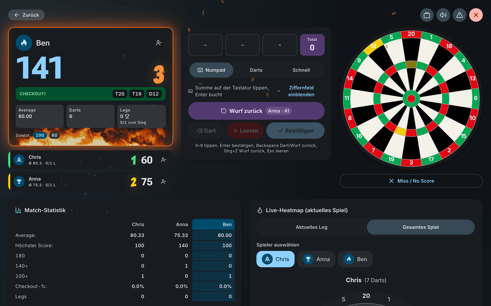

## 📱 Phone

Input docked in thumb reach, the other players as compact rows, stats and heatmap in a bottom sheet.

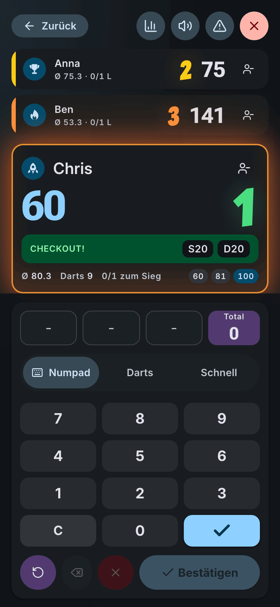

## 📺 TV scoreboard

`/scoreboard` on a second screen follows every visit live — with moments for 180, 100+, bust and won legs.

  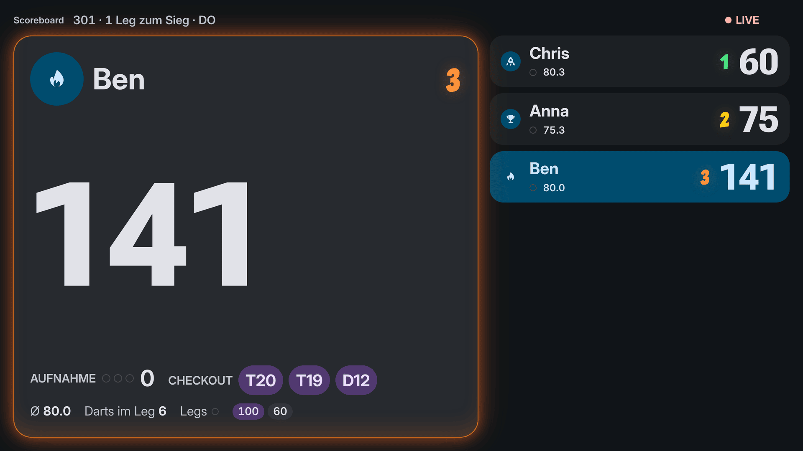
  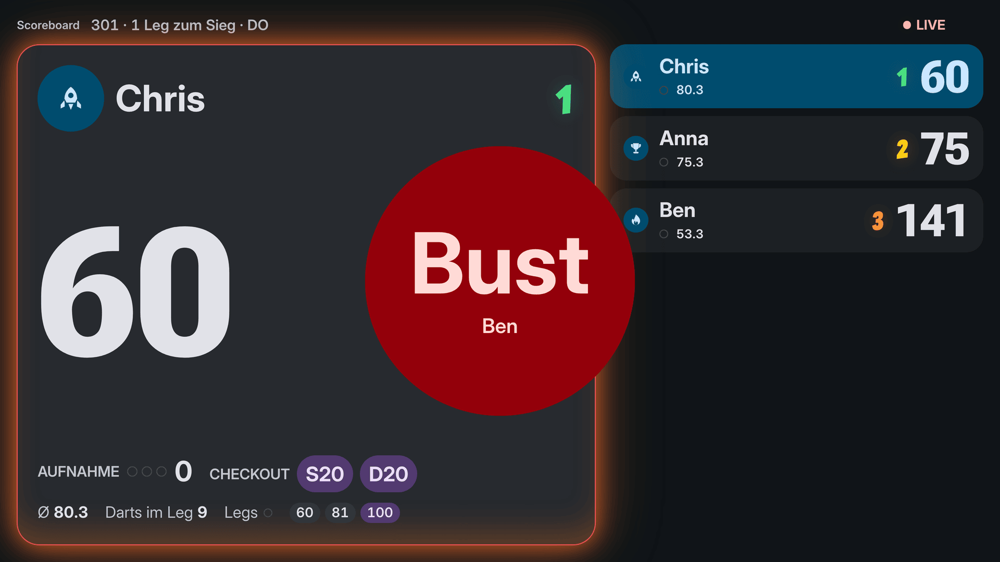

## 🎡 Who throws first?

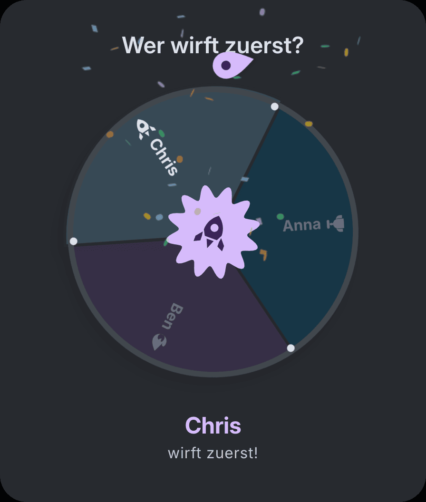

## 📊 Insights and statistics

  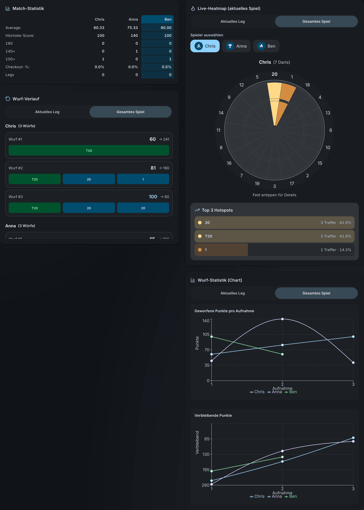
  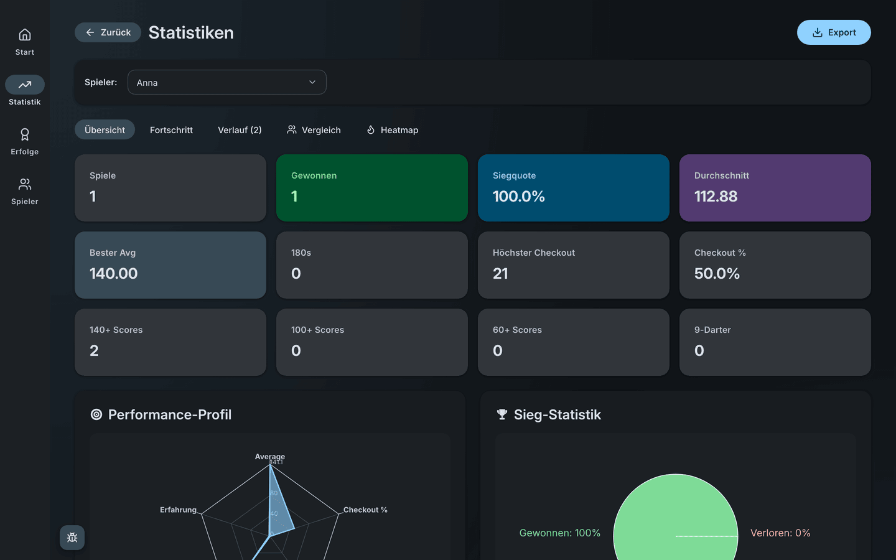

## 🏠 Home, players, history

  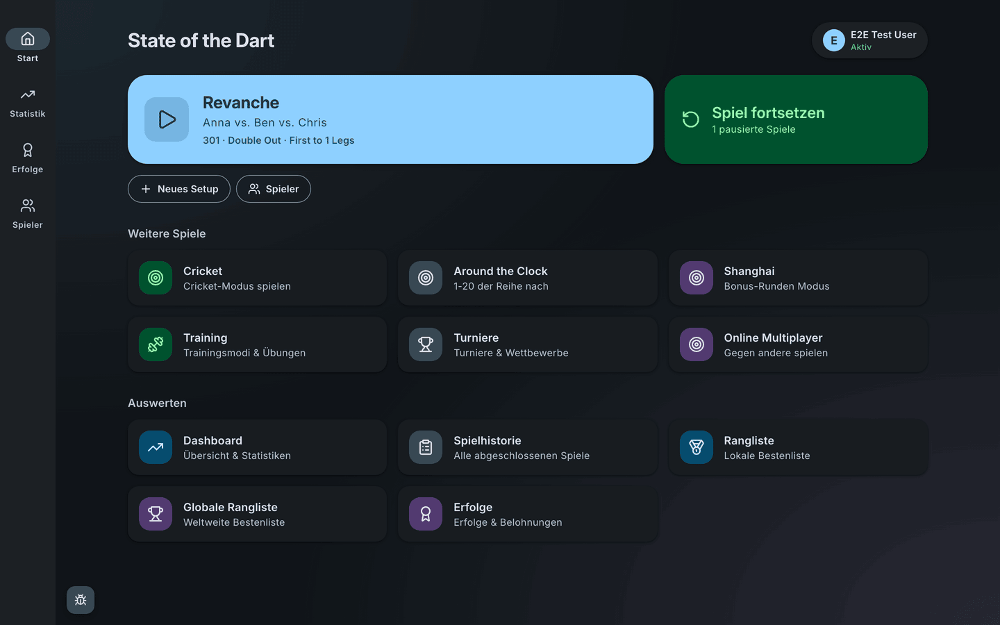
  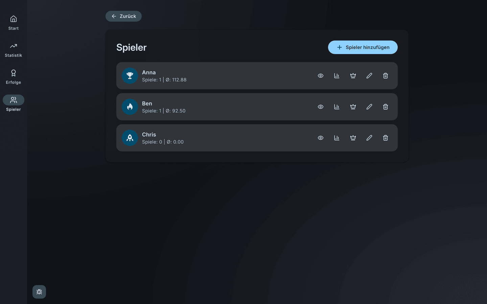
  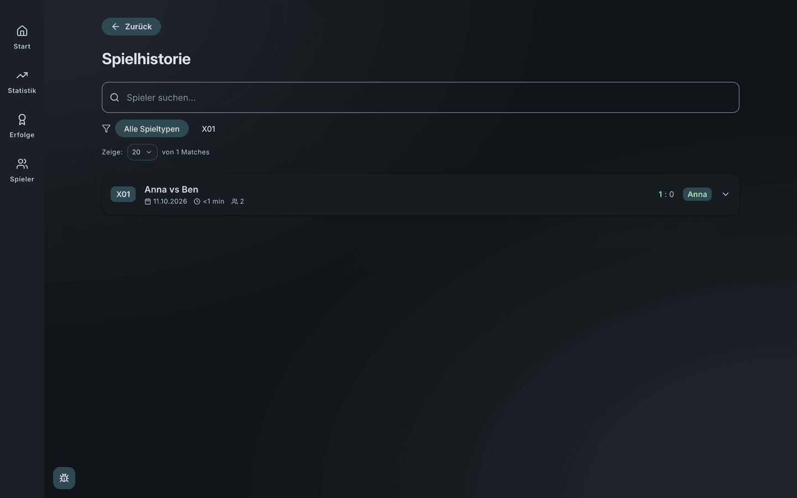

## 🏆 Achievements, leaderboard, training

  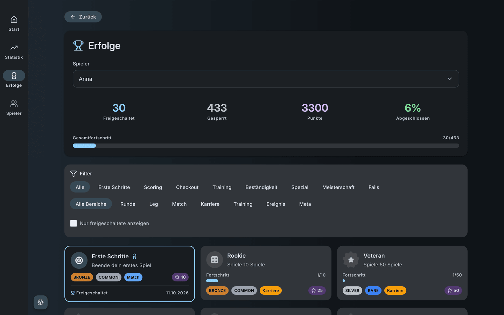
  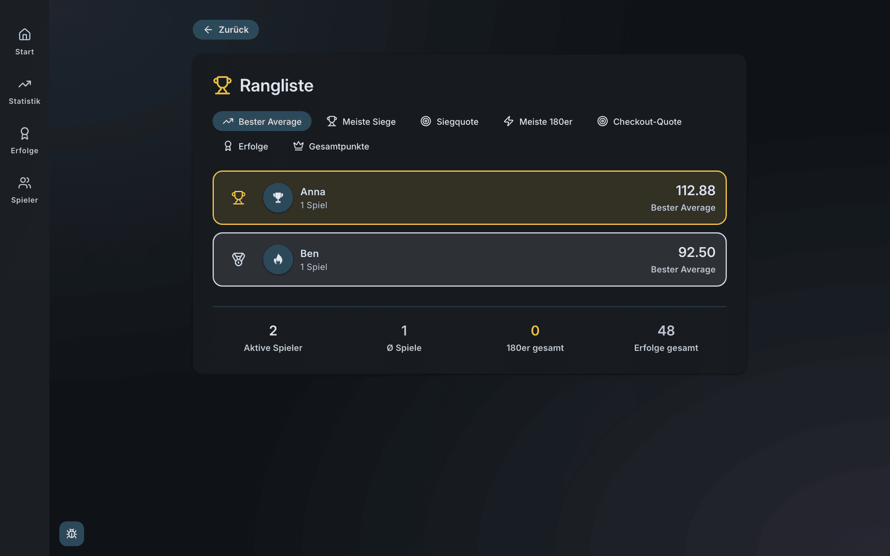
  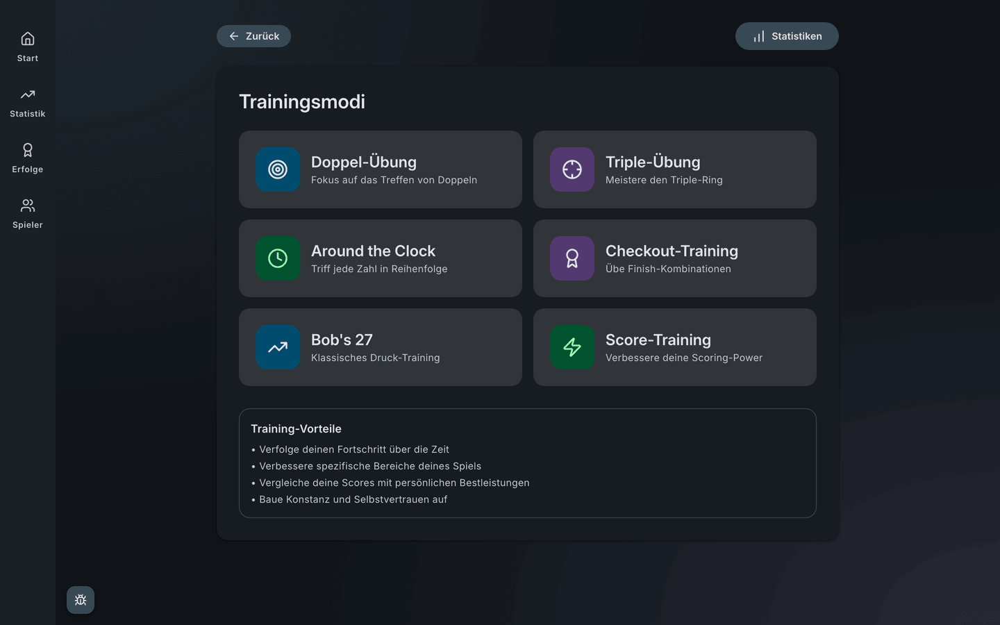

---

[MIT](LICENSE) — © 2026 Martin Pfeffer | [celox.io](https://celox.io)

